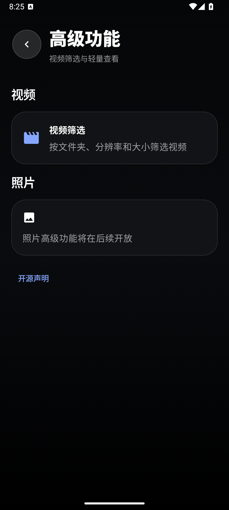

# 高级视频功能

“我的”页面的“整理记录”下面新增“高级功能”。高级功能首页分别展示照片和视频板块，本次实现视频筛选，照片板块明确标注后续开放。开源声明入口位于同一页面。

## 扫描范围

- 全部模式读取 Android MediaStore 中本应用已获授权的视频，包含已整理的视频，不受整理卡组的数量窗口和处理状态限制。
- 文件夹模式可以多选；目录列表显示完整相对路径、存储卷和视频数量。仅扫描所选目录，子目录需单独选择；不同存储卷的同名目录保持独立。
- 不包含应用私有目录、未被 MediaStore 索引的文件、待写入或系统已回收的视频。Android 14+ 的部分访问授权只能扫描系统选定的视频。
- 扫描只读元数据，不创建播放器或解码视频帧，不上传文件，也不修改整理状态、收藏、回收站或统计。
- 支持扫描进度、取消、重扫、错误重试。更改扫描范围会清除旧结果，避免把旧范围显示成新范围的结果。取消重扫保留上一次完整结果。

## 筛选与排序

多个条件取交集：视频名称、分辨率、文件大小、时长、格式、画面方向、添加时间。

| 条件 | 规则 |
| --- | --- |
| 分辨率 | 宽高短边：低于 720、720–1079、1080–2159、2160 及以上；另有未知元数据 |
| 大小 | 自定义最小/最大 MiB，边界均包含，留空表示不限；支持 100 MiB 以下、500 MiB 以上、1 GiB 以上快捷条件 |
| 时长 | 1 分钟以下、1 分钟至 10 分钟以下、至少 10 分钟、未知 |
| 画面方向 | MediaStore 宽高元数据对应的横屏、竖屏、方形、未知 |
| 格式 | MP4/M4V、MKV、WebM、MOV、其他；优先使用扩展名，缺失时使用 MIME |
| 添加时间 | MediaStore date_added 的最近 7/30/365 天，不等于视频拍摄时间 |
| 排序 | 最新、最早、大小升降序、分辨率降序、时长降序、名称 |

大小为 0、宽高为 0、时长为 0 表示元数据未知，不会当作已知的小文件或短视频匹配。大小输入验证非负数、数值溢出及上下界顺序。筛选与排序在 Default 调度器运行；扫描在 IO 调度器运行，可取消 ContentResolver 查询。MediaStore 元数据可能不完整或过时，本次不为补齐信息而逐个解码视频。

## 查看视频

内部查看使用已有 Media3 1.11.0 的 ExoPlayer 与 PlayerView，只有当前打开的视频会创建一个播放器。提供播放/暂停、拖动进度、快进/快退、静音和 1×/1.5×/2× 速度。进入后台暂停并释放播放器，返回时按保存的进度与播放状态恢复，关闭弹窗也释放播放器。静音仅改变播放器音量。

外部查看使用 Android ACTION_VIEW 选择器，传入具体 content URI、MIME 与临时只读 URI 授权，不传递全盘写入权限。没有可用查看器、文件已移除或权限变化时提供中文错误反馈。播放不支持的编码可直接转交外部应用。

## 代码与许可

数据模型与筛选在 `data/media/AdvancedVideo.kt`，只读扫描在 `AdvancedVideoScanner.kt`，通过 `AppRepository` 访问。`KanlemeViewModel` 持有 `AdvancedVideoLibrary` 状态，避免引入第二个全局 ViewModel。UI 与轻量播放器分别在 `AdvancedVideoScreen.kt` 和 `LightweightVideoViewer.kt`。

第三方来源、版本、修改和许可证见 [第三方声明](third_party_notices.md)。本次不添加任何播放器依赖，不引入 FFmpeg、下载、后台服务或云同步。

## 性能与视觉约定

- 文件夹索引与完整扫描均在 IO 调度器执行，Cursor 列索引仅解析一次；每 100 条记录发布一次进度，取消时通过 CancellationSignal 终止查询。
- 进度、目录刷新与错误状态变化不会重新筛选或排序旧结果。搜索与筛选输入合并 120 ms，过期任务在遍历和排序中每 256 次操作检查取消。
- 筛选只分配一个结果列表并原地排序；名称排序直接忽略大小写比较，不在每次比较时创建小写字符串。不指定格式条件时跳过扩展名解析。
- 列表使用 LazyColumn 和完整 content URI 作为稳定 key。扫描列表不加载缩略图或播放器；只在打开查看器时创建一个播放器。
- 查看器使用 8 MiB 的媒体采样缓冲目标、1.5–8 秒缓冲区间、零回退缓冲。该目标不代表进程总内存上限，解码器、Surface 和系统组件仍会分配内存。
- 新页面复用 `ProfileDarkPage`、`ProfilePageHeader`、`ProfilePanel` 与 `ProfileScreenAccent`，沿用“我的”现有的深色渐变、蓝色强调、返回圆钮、卡片圆角和内容居中组件。筛选弹层使用相同深色与圆角；手机和平板均保持同一套视觉元素。

全盘元数据和筛选结果在浏览期间驻留于当前 ViewModel，内存随视频数量线性增长；正常离开页面会清空视频与文件夹列表，并立即停止结果流和清理回放缓存，配置变化则保留已完成扫描以便恢复查看。目前不声称所有设备都能在任意媒体数量下达到固定内存或帧率。需要进一步扩大规模时应改为分页查询，并保持筛选语义和全量结果计数。

## 验证边界

JVM 用例覆盖分辨率短边与档位边界、未知元数据、时长边界、大小输入与溢出、多个条件取交集、格式与日期、超过卡组窗口的结果、跨卷稳定排序、筛选/排序取消、过期扫描结果拦截和退出缓存清理。

2026-10-05 使用 API 36 模拟器、独立数据分区及自制 3 秒 MP4，分别以手机 1080×2400 和平板 1600×2560 窗口运行 5 项设备测试。验证入口、照片占位说明、离线许可证、真实文件夹扫描、内部播放进度、静音、后台释放/恢复、关闭释放和外部只读 URI 打开。外部目标为模拟器中的 Google Photos，已确认显示合成视频画面。未使用真实用户媒体或连接实体手机。

50,000 条合成视频元数据按分辨率过滤并按名称排序，在模拟器上的 7 次测量中位数为 22–30 ms（不同测试轮次）；测试预热 3 次，结果数量完整。该数字是后台元数据筛选耗时，不是全盘 MediaStore 扫描耗时、视频解码性能或设备帧率保证。构建与检查的最终结果见交付说明。

可重跑设备用例：`./gradlew :app:connectedDebugAndroidTest -Pandroid.testInstrumentationRunnerArguments.class=com.futureape.kanleme.ui.screens.AdvancedVideoDeviceTest`。测试视频的来源与生成命令见 [合成样本说明](../app/src/androidTest/assets/advanced-video/README.md)。

  
  
  

