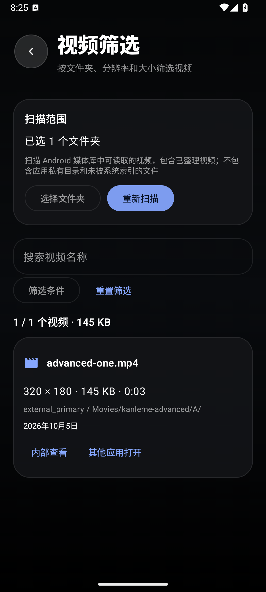
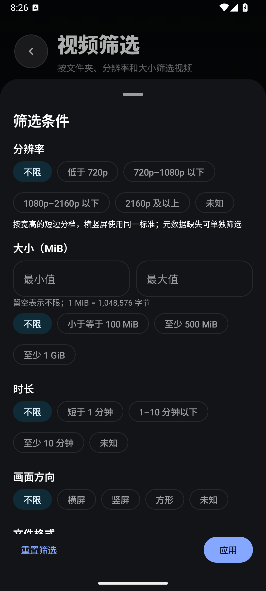

# 高级视频功能

“我的”页面的“整理记录”下面新增“高级功能”。高级功能首页分别展示照片和视频板块，本次实现视频筛选，照片板块明确标注后续开放。开源声明入口位于同一页面。

## 扫描范围

- 全部模式读取 Android MediaStore 中本应用已获授权的视频，包含已整理的视频，不受整理卡组的数量窗口和处理状态限制。
- 文件夹模式可以多选；目录列表显示完整相对路径、存储卷和视频数量。默认包含子文件夹，可关闭该选项以只扫描所选目录；不同存储卷的同名目录保持独立。支持从系统文件管理器选择扫描目录。
- 不包含应用私有目录、未被 MediaStore 索引的文件、待写入或系统已回收的视频。Android 14+ 的部分访问授权只能扫描系统选定的视频。
- 扫描只读元数据，不创建播放器或解码视频帧，不上传文件，也不修改整理状态、收藏、回收站或统计。
- 支持扫描进度、取消、重扫、错误重试。更改扫描范围会清除旧结果，避免把旧范围显示成新范围的结果。取消重扫保留上一次完整结果。

## 筛选与排序

多个条件取交集：视频名称、分辨率、码率估算、文件大小、时长、格式、画面方向、添加时间。

| 条件 | 规则 |
| --- | --- |
| 分辨率 | 宽高短边：低于 720、720–1079、1080–2159、2160 及以上；另有未知元数据 |
| 码率估算 | 文件大小 × 8 ÷ 时长，得到含音频与容器开销的平均总码率；与对应分辨率参考值比较，提供低于 50%、50–100%、100–150%、150% 及以上和未知筛选 |
| 大小 | 自定义最小/最大 MiB，边界均包含，留空表示不限；支持 100 MiB 以下、500 MiB 以上、1 GiB 以上快捷条件 |
| 时长 | 1 分钟以下、1 分钟至 10 分钟以下、至少 10 分钟、未知 |
| 画面方向 | MediaStore 宽高元数据对应的横屏、竖屏、方形、未知 |
| 格式 | MP4/M4V、MKV、WebM、MOV、其他；优先使用扩展名，缺失时使用 MIME |
| 添加时间 | MediaStore date_added 的最近 7/30/365 天，不等于视频拍摄时间 |
| 排序 | 最新、最早、大小升降序、分辨率降序、时长降序、码率降序、名称 |

码率参考采用 SDR 常规帧率的 H.264 上传建议档位：360p 1 Mbps、480p 2.5 Mbps、720p 5 Mbps、1080p 8 Mbps、1440p 16 Mbps、2160p 35 Mbps，参考 [YouTube 推荐上传编码设置](https://support.google.com/youtube/answer/1722171?hl=en)。这是参考值，不是通用画质标准；帧率、编码格式、HDR、音轨及容器开销都会改变实际码率与画质关系，因此界面使用“估算/参考”措辞。

大小为 0、宽高为 0、时长为 0 表示元数据未知，不会当作已知的小文件、短视频或码率档位匹配。大小输入验证非负数、数值溢出及上下界顺序。筛选与排序在 Default 调度器运行；扫描在 IO 调度器运行，可取消 ContentResolver 查询。MediaStore 元数据可能不完整或过时，本次不为补齐信息而逐个解码视频。

## 查看视频

结果卡片采用 112×72 dp 的紧凑封面与右侧标题布局，依次使用 Android `ContentResolver.loadThumbnail()`、Media3 `FrameExtractor` 和 `MediaMetadataRetriever` 本地生成封面；失败项短暂退避后重试一次。解码结果会缩放到 256×160 以内。完整画面按比例显示，时长覆盖在右下角。点击封面或标题可进入内部查看。系统和两套解码器都无法读取时提供占位，仍可通过其他查看器打开。

筛选结果支持列表与网格切换；网格列数随可用宽度调整。网格卡片点击封面或标题可在应用内播放；其他应用打开、移动和删除放在卡片操作菜单中。照片和视频筛选页会显示已启用的筛选条件数量，并可一键清除搜索内容。照片预览可在当前筛选结果中切换、双击或双指缩放；长图使用分块查看器，避免一次解码完整大图。

内部查看使用已有 Media3 1.11.0 的 ExoPlayer 与 PlayerView，只有当前打开的视频会创建一个播放器。提供播放/暂停、拖动进度、快进/快退、静音和 0.5× 至 2× 倍速，并可在当前筛选结果中切换上一条或下一条；删除和移动位于更多操作菜单。播放器顶部提供横竖屏切换，系统返回键可先恢复原来的方向，关闭播放器时也会恢复进入前的方向设置。切换方向与进入后台时保存播放进度、播放状态及音量，返回后恢复；后台和关闭时均释放播放器。长按画面临时以 2× 播放，松开后恢复所选倍速；中间区域横向拖动会显示目标进度并在松开后定位，底部进度条在拖动时即时 seek。画面左侧上下滑动调节播放器窗口亮度，右侧上下滑动调节本地播放器音量，左右双击快退或快进 10 秒，中间双击播放或暂停；这些手势不改系统亮度或全局媒体音量，说明可从更多操作中查看。静音仅改变播放器音量，再次开启时恢复静音前的音量。

项目当前以 API 36 为目标，主 Activity 通过 Android 16 的临时兼容属性允许大屏设备响应播放器的方向请求；用户关闭播放器后恢复原方向设置。某些平板可能由系统以兼容窗口显示横屏内容，分屏或设备策略也可能忽略方向请求，此时播放器会给出提示。升级到目标 API 37 时需重新设计大屏手动旋转方案，因为该兼容属性届时不再生效（参见 [Android 16 行为变更](https://developer.android.com/about/versions/16/behavior-changes-16)）。

外部查看使用 Android ACTION_VIEW 选择器，传入具体 content URI、MIME 与临时只读 URI 授权，不传递全盘写入权限。没有可用查看器、文件已移除或权限变化时提供中文错误反馈。播放不支持的编码可直接转交外部应用。

## 删除与移动

列表卡片和内部查看器都提供删除、移动入口。

- 删除需要确认，并固定先进入应用回收站，即使常规整理页面配置为系统回收站。保留原有收藏/整理状态，可从“我的 → 回收站”恢复；本页没有永久删除入口。
- 点击移动会调用 Android 系统文件管理器选择目标目录，不提供手工路径输入。支持内部存储和存储卡的本地目录，在系统选择器内可以新建文件夹；移动目标须与源视频位于同一存储卷。选定目录映射到 MediaStore 路径后，目标是否允许由 Android MediaStore 验证。
- 写入权限沿用现有系统授权流程，取消授权保留原文件与原路径。成功后读取该视频的最新元数据，更新标题、路径与封面缓存版本；若移出当前扫描范围，则从当前结果中移除。
- 动作开始前只查询当前视频，校验 URI、文件名、大小、目录和修改时间。发现视频已变化时要求重扫，避免操作过时的预览。已有媒体的本地收藏、统计与历史记录保持原 ID，不重新创建。
- 应用回收站中的视频不会在高级扫描结果中重复显示。并发操作按 URI 去重，处理期间停用该条目的删除/移动与重扫。

## 代码与许可

数据模型与筛选在 `data/media/AdvancedVideo.kt`，只读扫描在 `AdvancedVideoScanner.kt`，通过 `AppRepository` 访问。`KanlemeViewModel` 持有 `AdvancedVideoLibrary` 状态，避免引入第二个全局 ViewModel。UI 与轻量播放器分别在 `AdvancedVideoScreen.kt` 和 `LightweightVideoViewer.kt`。

第三方来源、版本、修改和许可证见 [第三方声明](third_party_notices.md)。播放仍使用 Media3 ExoPlayer；封面解码增加同版 Media3 FrameExtractor/effect，不引入第二个播放器、FFmpeg、下载、后台服务或云同步。

## 性能与视觉约定

- 文件夹索引与完整扫描均在 IO 调度器执行，Cursor 列索引仅解析一次；每 100 条记录发布一次进度，取消时通过 CancellationSignal 终止查询。
- 进度、目录刷新与错误状态变化不会重新筛选或排序旧结果。搜索与筛选输入合并 120 ms，过期任务在遍历和排序中每 256 次操作检查取消。
- 筛选只分配一个结果列表并原地排序；名称排序直接忽略大小写比较，不在每次比较时创建小写字符串。不指定格式条件时跳过扩展名解析。
- 结果列表与网格都使用 LazyColumn 懒加载；列表以视频 content URI 为稳定 key，网格以每行首个视频 URI 为稳定 key。扫描阶段不解码封面；封面仅在条目进入 Compose 时读取，最多两路并发、256×160 像素上限、8 MiB LRU 缓存，查询可取消。失败封面短期缓存 30 秒避免反复读取；离开页面与权限变化时清空缓存。只有打开查看器才创建播放器。
- 查看器使用 8 MiB 的媒体采样缓冲目标、1.5–8 秒缓冲区间、零回退缓冲。该目标不代表进程总内存上限，解码器、Surface 和系统组件仍会分配内存。
- 新页面复用 `ProfileDarkPage`、`ProfilePageHeader`、`ProfilePanel` 与 `ProfileScreenAccent`，沿用“我的”现有的深色渐变、蓝色强调、返回圆钮、卡片圆角和内容居中组件。筛选弹层使用相同深色与圆角；手机和平板均保持同一套视觉元素。

全盘元数据和筛选结果在浏览期间驻留于当前 ViewModel，内存随视频数量线性增长；正常离开页面会清空视频与文件夹列表，并立即停止结果流和清理回放缓存，配置变化则保留已完成扫描以便恢复查看。目前不声称所有设备都能在任意媒体数量下达到固定内存或帧率。需要进一步扩大规模时应改为分页查询，并保持筛选语义和全量结果计数。

## 验证边界

JVM 用例覆盖分辨率短边与档位边界、未知元数据、时长边界、大小输入与溢出、多个条件取交集、格式与日期、超过卡组窗口的结果、跨卷稳定排序、筛选/排序取消、过期扫描结果拦截和退出缓存清理。

2026-10-05 使用 API 36 模拟器、独立数据分区及自制 3 秒 MP4，分别以手机 1080×2400 和平板 1600×2560 窗口运行 11 项设备测试。验证入口、照片占位说明、离线许可证、真实文件夹扫描、内部播放进度、静音、后台释放/恢复、关闭释放、外部只读 URI 打开、系统目录选择、目录递归/转义去重、回收站恢复、移动批准/取消及封面缓存上限。外部目标为模拟器中的 Google Photos，已确认显示合成视频画面。未使用真实用户媒体或连接实体手机。

50,000 条合成视频元数据按分辨率过滤并按名称排序，在模拟器上的 7 次测量中位数为 21–30 ms（不同测试轮次）；测试预热 3 次，结果数量完整。该数字是后台元数据筛选耗时，不是全盘 MediaStore 扫描耗时、视频解码性能或设备帧率保证。构建与检查的最终结果见交付说明。

可重跑设备用例：`./gradlew :app:connectedDebugAndroidTest -Pandroid.testInstrumentationRunnerArguments.class=com.futureape.kanleme.ui.screens.AdvancedVideoDeviceTest`。测试视频的来源与生成命令见 [合成样本说明](../app/src/androidTest/assets/advanced-video/README.md)。

  
  
  

目录移动测试使用真实系统文件管理器选择目标；写入批准/取消回调针对测试 App 自己创建的视频进行模拟，再验证真实 MediaStore 更新与原文件保留。实体设备上的第三方视频写入授权对话框尚未验收；当前移动仅支持同一存储卷。

## 文件夹随机播放

“我的 → 高级功能 → 文件夹随机播放”通过系统文件夹选择器选定设备存储或存储卡目录，选择后立即扫描并播放。可选择是否包含子文件夹；目录直接通过系统授予的树形 URI 读取，因此不依赖视频已经被 MediaStore 索引。应用不会上传视频，也不会修改文件。系统禁止授权的目录仍由系统选择器限制，虚拟文档不加入队列。

每次扫描将找到的视频打乱一次，以该顺序逐个播放并循环；播放期间可使用上一条、下一条、暂停、倍速、手动横竖屏切换和原有手势。关闭播放器后可重新播放当前列表，顺序不变并从列表开头开始；选择其他文件夹或重新扫描可更新列表并重新打乱顺序，扫描完成后的文件变化需要重新扫描才能反映。单个视频会循环播放；无法播放的项目会跳过，如果队列中的项目连续全部失败则停止并显示重试提示。播放器进入后台或关闭时沿用现有资源释放流程。目录读取与打乱在后台执行，队列随视频数量线性占用内存；系统授予的目录访问用于当前会话，不额外持久保存授权。
