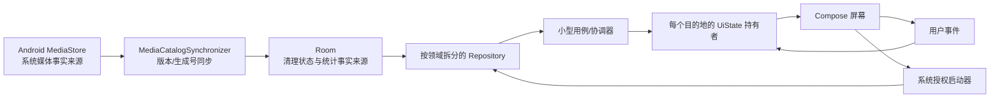
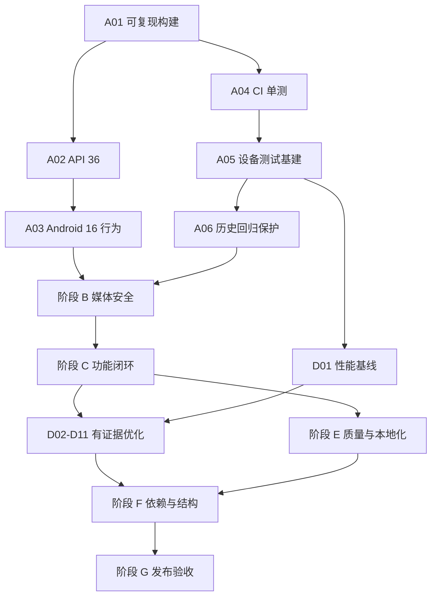

# 看了么（Keepix）全仓库审计、功能完善与性能优化实施规划

> 文档状态：实施前审计快照；当前执行状态见第 18 节
> 审计基线：`main` / `6d0557c`
> 审计日期：2026-08-12（Asia/Shanghai）
> 当前应用版本：`2.3.4`（`versionCode 60`）
> 当前数据库版本：Room `16`
> 原始审计轮次边界（2026-08-12）：只读扫描、互联网调研和规划；当时未修改业务代码、未运行 Gradle 构建、未创建提交

## 1. 目标与不可突破的边界

本计划的目标不是做一次“大扫除式重构”，而是把仓库中已经存在但没有完成闭环的能力、数据语义、系统授权、测试缺口和性能风险，拆成能够独立验证、独立提交、独立回退的小交付块。

整个实施过程必须同时满足以下产品边界：

- 应用继续保持本地优先，不新增账号、会员、支付、广告、订阅或云同步
- 不把用户照片、视频、指纹、EXIF 或清理记录上传到任何服务器
- 所有媒体删除先进入看了么自己的回收站；永久删除必须由用户再次确认，并经过 Android 系统授权
- 不为了优化而破坏现有手机布局；平板、折叠屏和多窗口适配必须在保留手机体验的前提下推进
- UI 继续使用中文作为默认语言，项目名称始终为“看了么”或 `kanleme`
- 任何 Room Entity 或数据库版本变动都必须同步 `app/schemas/`；当前仓库约定继续使用 `fallbackToDestructiveMigration()`，未经单独产品决策不引入手写迁移
- 不提交签名文件、密码、`local.properties`、本机私有资料或构建产物
- 现有已修复交互——首开首页预览、往年今日入口、队列随机顺序、视频静音、照片滑动音效——必须先转成回归验收项，不能在后续重构中悄悄退化

## 2. “全面扫描”的范围定义

### 2.1 已覆盖的版本控制范围

本次只读审计以 `git ls-files` 为权威清单，共覆盖 129 个受版本控制文件：

| 类别 | 文件数 | 审计方式 |
| --- | ---: | --- |
| 主 Kotlin 代码 | 60 | 逐目录读取、符号/调用点/状态流/权限路径检索、热点文件行数统计 |
| JVM 单元测试 | 2 | 读取测试目标、断言范围和缺失的测试层级 |
| Android 资源 | 17 | XML 解析、字符串键集合对比、图片/音频元数据检查 |
| Room Schema | 4 | JSON 解析、版本连续性与 Entity/DAO 使用情况核对 |
| 文档及截图 | 24 | 版本信息、链接、功能描述、截图可读性与漂移核对 |
| GitHub/CI 配置 | 4 | 工作流、Issue/PR 模板和实际门禁核对 |
| 根目录与构建配置 | 18 | Gradle、Wrapper、许可证、公开仓库白名单和发布配置核对 |

统计补充：仓库内 62 个 Kotlin 文件合计约 22,898 行，其中 22 个屏幕文件约 14,370 行；测试仅 2 个文件、约 107 行。这个比例说明后续第一优先级必须是“先建立表征测试，再改行为”。

### 2.2 二进制与结构化文件的覆盖方式

- 14 个受版本控制 XML 均完成结构解析
- 4 个 Room Schema JSON 均完成结构解析，版本为 13、14、15、16
- 13 张公开界面截图可读取；手机截图为 1200×2670，平板截图为 2560×1600
- 启动图标位图可读取，尺寸为 1254×1254
- 3 个滑动音效文件存在，大小约为 14 KB、66 KB、20 KB
- `gradle-wrapper.jar` 作为二进制构建基础设施登记在案；实施阶段还需增加 Wrapper 完整性/来源核验

### 2.3 有意不读取内容的范围

以下项目只核对“是否存在、是否被忽略”，不读取其内容：

- `.git/`、`.gradle/`、`.kotlin/`、`build/`、`app/build/`
- `local.properties`
- 本机签名材料及密码
- `local-private/` 等本机私有目录
- 未纳入公开仓库的本地笔记、临时脚本和打包产物

这不是扫描遗漏，而是安全边界。后续若需要验证“干净克隆可构建”，应从 `git archive` 或临时 clone 创建一个不含本机秘密的独立目录，不把本机文件复制进去。

### 2.4 本轮没有证明的事项

由于用户要求本轮先只给规划，因此以下内容仍是“待执行验证”，不能写成已经通过：

- 当前 Debug/Release 是否能从干净克隆编译
- 单元测试、Lint、kapt、R8 是否通过
- APK 是否为最新代码产生，签名是否正确
- 真机上的系统删除/恢复授权、局部照片权限、音效、静音、TalkBack、折叠屏表现
- 性能基线、内存峰值、掉帧、扫描耗时和相似照片吞吐量

## 3. 当前基线画像

### 3.1 构建与平台

| 项目 | 当前值 | 规划判断 |
| --- | --- | --- |
| AGP | 8.8.2 | 不足以作为 API 36 的长期基线 |
| Gradle Wrapper | 8.10.2 | 与 AGP 8.8 对齐；API 36 路线需升级 |
| Kotlin | 2.0.21 | 先保持，避免与平台升级混在一个提交 |
| Java | 17 | 保持 |
| `compileSdk` / `targetSdk` | 35 / 35 | 2026-08-31 前必须完成 API 36 发布适配 |
| `minSdk` | 30 | 保持 Android 11 起步，不扩大兼容面 |
| Compose | 1.8.2 | 可用但已明显落后；必须分家族升级 |
| Material 3 | 1.3.2 | 与 Compose 家族一起评估 |
| Room | 2.7.1 | Schema 已导出；升级与数据语义修复分开 |
| WorkManager | 2.10.1 | 已依赖但没有 Worker 使用 |
| Media3 | 1.6.1 | 播放生命周期基本有释放，但版本与预加载能力落后 |
| Coil | 2.7.0 | 当前为单例 ImageLoader；升级 3.x 必须独立处理 |
| Release | R8 + resource shrink | 每个 R8 敏感块必须额外跑 Release 构建 |

### 3.2 体量与高耦合热点

| 文件 | 约行数 | 当前风险 |
| --- | ---: | --- |
| `SettingsScreen.kt` | 2,306 | 设置、预览、帮助、诊断和多个私有组件混在一个文件 |
| `KanlemeViewModel.kt` | 1,709 | 单一 ViewModel 同时拥有首页、照片、视频、相似、回收站、报告和设置状态 |
| `MediaCards.kt` | 1,565 | 卡片渲染、手势、实况播放、预取和多种覆盖层耦合 |
| `PhotoCleanScreen.kt` | 1,268 | 会话、手势、预取、引导和反馈耦合 |
| `AppRepositoryImpl.kt` | 1,251 | 扫描、清理、移动、统计、报告、成就和撤销集中在单类 |
| `ImmersivePhotoCleanScreen.kt` | 1,154 | 沉浸式布局与行为逻辑耦合 |
| `VideoCleanScreen.kt` | 1,096 | Pager、播放器、音频、手势与操作 UI 集中 |
| `LocalizedText.kt` | 713 | 用运行时中文文本映射替代标准资源系统，维护成本高 |

这些文件不能直接按“行数大”拆分。必须先把行为写成测试，再把状态生产、业务规则和纯 UI 分离，否则重构会让真实交互路径发生漂移。

### 3.3 测试与 CI

当前只有：

- `MediaStoreActionsTest.kt`
- `AppRepositoryStatsTest.kt`

没有：

- `androidTest` 目录
- Compose UI 测试
- Room DAO/数据库真机或模拟器测试
- ViewModel 协程状态测试
- 权限与系统授权契约测试
- 截图测试
- Macrobenchmark、Microbenchmark 或 Baseline Profile
- 测试媒体 fixture

现有 GitHub Actions 会构建 Debug、运行 `lintDebug`、运行 Debug/Release kapt、构建 Release，但没有执行 `testDebugUnitTest`。因此 CI 即使为绿色，也不能证明当前仅有的单元测试通过。

## 4. 已发现问题与风险登记表

优先级定义：

- **P0**：发布、数据安全、系统授权或用户被明显误导；先处理
- **P1**：现有功能不完整、数据不可信、主要性能/可用性风险
- **P2**：结构债、维护成本、低频缺陷或需测量后判断的优化
- **P3**：文档整洁度和非阻塞式改进

### 4.1 P0：实施首批必须闭环

| ID | 发现 | 证据与影响 | 目标交付块 |
| --- | --- | --- | --- |
| P0-01 | API 36 发布时限 | 2026-08-31 起，Google Play 手机应用的新版本必须面向 Android 16/API 36；当前为 35 | A02、A03 |
| P0-02 | Release 配置不可复现 | `app/build.gradle.kts` 引用 `app/proguard-rules.pro`，该文件在本机存在但被白名单式 `.gitignore` 排除；干净克隆没有它 | A01 |
| P0-03 | 媒体操作授权链不完整 | 移动文件、放入/移出系统回收站直接调用 `ContentResolver.update()`；安全异常只变成错误字符串，没有系统授权重试 | B03～B05 |
| P0-04 | 存在可绕过 UI 授权的永久删除 API | Repository 仍公开直接 `resolver.delete()` 的永久删除路径，虽当前回收站 UI 使用 `createDeleteRequest()`，未来调用者可能误用 | B06 |
| P0-05 | `FileProvider` 范围过宽 | `cache-path`、`external-cache-path`、`files-path` 均配置 `path="."`；官方明确建议避免共享 `.` | B01 |
| P0-06 | “30 天安全期”与真实机制不一致 | `autoDeleteAt` 只写入并用于倒计时，没有 Worker/DAO 自动清理；系统也不会替看了么本地回收站自动执行授权删除 | B07 |
| P0-07 | 年度报告不是年度数据 | `buildAnnualReport(year)` 接收年份，却返回当前全库总数、当前待删数和全量相册 Top Folder | C10 |
| P0-08 | 第三方音效授权证据缺失 | 源码注释说明音效来自外部作者，但受版本控制的 `NOTICE` 没有音效来源、许可证或再分发依据 | A07 |

### 4.2 P1：功能真实度、数据正确性与主要质量风险

| ID | 发现 | 证据与影响 | 目标交付块 |
| --- | --- | --- | --- |
| P1-01 | 多个设置只有存储或预览，没有真实页面消费 | `quickActionButtons`、`swapShareAndUndo`、`immersiveBackground`、`photoCleanMode`、`photoShowActionRail`、`videoShowFolderChips` 未形成运行时闭环；照片若干组件开关只影响设置预览 | C01～C04 |
| P1-02 | “自动相似检测”并不自动/持久 | 只有切换为开时在 ViewModel 进程内启动一次；重启、进程死亡或保持开关时不会续跑 | C08 |
| P1-03 | 统计口径不能支撑文案 | 成就“删除”使用当前待删数量而非累计删除；连续天数字段没有完整更新链；日报“动作数”按事件行数计算 | C09、C11 |
| P1-04 | 回收站恢复/批量操作没有统一授权与部分失败模型 | 恢复逐项直接更新，失败可能导致系统状态与 Room 状态不同步 | B04、B06 |
| P1-05 | Android 14+ 局部媒体权限需系统化验证 | 已声明和检查 `READ_MEDIA_VISUAL_USER_SELECTED`，但必须补“局部、重新选择、从设置撤销、只图片/只视频”全流程 | B08 |
| P1-06 | 未使用或用途不成立的敏感权限 | `POST_NOTIFICATIONS` 与 `ACCESS_MEDIA_LOCATION` 没有完整请求/消费链；后者关联敏感 EXIF 位置 | B02 |
| P1-07 | 外部分享入口接受未校验 URI | `PhotoCompareActivity` 为 exported，接收最多 4 个外部 URI，但未严格限制 scheme、MIME、持久/临时读取权限和异常文件 | B09 |
| P1-08 | 国际化资源不闭环 | 英文、繁中、台湾繁中各缺 6 个滑动音效字符串；大量中文硬编码依靠 713 行运行时映射兜底 | E01～E05 |
| P1-09 | 全局密度缩放可能破坏无障碍 | `MainActivity` 按宽度覆盖 `LocalDensity`/字体比例，可能抵消用户字体大小、掩盖布局问题 | E07 |
| P1-10 | 没有 UI、无障碍或设备级回归测试 | 高手势密度应用缺少 TalkBack、语义动作、48dp 触控目标和关键导航自动测试 | A05、E06 |
| P1-11 | 全量 MediaStore 扫描成本会随图库增长 | 当前刷新扫描全库、全量组装列表、批量查询旧记录并先 `markAllMissing`；未使用版本/生成号增量同步 | D04 |
| P1-12 | 图片预取可能造成解码与内存浪涌 | 多个网格首轮主动 `execute` 42～48 张，滚动再向前预取约 48～54 张；需要测量后缩小或交给可取消预取 | D07 |
| P1-13 | 相似照片分析不具备可靠后台语义 | DCT/哈希运行在 ViewModel scope，进程死亡即中断；持久 LSH 表未使用，WorkManager 依赖闲置 | C08、D08 |
| P1-14 | 数据表增长没有保留策略 | `operation_history`、缺失媒体标记和若干统计记录没有清理边界 | D05 |
| P1-15 | 工具链与依赖明显落后 | 当前版本与 2026 年官方稳定线相差多个大版本；一次性升级会同时触发 API、R8、Compose、Media3 和 kapt 风险 | F01～F05 |

### 4.3 P2/P3：结构、死代码和文档漂移

| ID | 发现 | 证据与影响 | 目标交付块 |
| --- | --- | --- | --- |
| P2-01 | 多个 Entity 只有声明、没有 DAO/业务消费 | `LshBucketEntity`、`FolderFilterEntity`、`FolderUsageEntity`、`SwipeStatisticsEntity`、`SwipeStatSessionEntity`、`AchievementProgressEntity`、`BackupImportAuditLogEntity`、`DeviceModelCacheEntity` | C12 |
| P2-02 | 依赖存在但无代码使用 | WorkManager/Hilt Work、ExifInterface 当前没有使用点；应完成对应功能或移除 | B02、C08、F03 |
| P2-03 | 导航与 API 有不可达/空实现 | `PHOTO_START`、`VIDEO_START` 当前没有正常入口；`FloatingGlassNav.onAdd` 传空函数 | C07 |
| P2-04 | 文档与代码版本漂移 | 多份文档仍写 2.3.1/code 57；当前为 2.3.4/code 60 | G01 |
| P2-05 | README 链接到不存在的发布说明 | 中英文 `release_notes.md` 均未纳入当前跟踪清单 | A01、G01 |
| P2-06 | 单一 ViewModel/Repository 与大量屏幕流导致重组面过大 | 屏幕直接收集多条 Flow，状态变化容易扩大重组范围；测试隔离困难 | D06、D10、F06 |
| P2-07 | 视频页没有确认的泄漏，但播放器切页重建成本待测 | 代码只为当前页创建 ExoPlayer，并在 `DisposableEffect` 释放；优化重点应是切页启动时延和资源抖动，而不是先假设泄漏 | D09 |
| P2-08 | 实况视频提取和缓存有重复实现/厂商兼容风险 | 尾部扫描、临时文件和缓存裁剪均为自研；需要真实 OEM fixture 与超时/损坏文件测试 | D08、E09 |
| P3-01 | 每日分享图和部分帮助文本仍硬编码中文 | 影响非中文语言和文案一致性 | E05 |
| P3-02 | 崩溃日志分享缺少显式隐私提示 | 日志含设备型号和堆栈，虽由用户主动导出，仍应在分享前说明内容 | B01、G01 |

## 5. 官方互联网调研结论

本轮技术调研优先使用 Android、Google Play、AndroidX、Kotlin 和 Coil 官方资料。所有版本信息均以 2026-08-12 的页面状态为准，真正执行对应块前还要再查一次稳定版本与已知问题。

| 主题 | 官方结论 | 对本项目的直接影响 |
| --- | --- | --- |
| Google Play 目标 API | [2026-08-31 起，新应用和更新需面向 API 36](https://support.google.com/googleplay/android-developer/answer/11926878?hl=en-GB_ALL) | API 36 是时限任务，不应等所有结构优化完成 |
| Android 16 SDK | [API 36 设置指南](https://developer.android.com/about/versions/16/setup-sdk)要求合适的 AGP，并将 `compileSdk/targetSdk` 升到 36 | 推荐先用仍保留当前 Kotlin/kapt 模式的 AGP 8.13.x 路线完成发布合规 |
| Android 16 行为变化 | [面向 API 36 的变化](https://developer.android.com/about/versions/16/behavior-changes-16)包括强制 edge-to-edge、预测返回和大屏可调整性 | 必须在 API 36 提交后单独做行为测试，不把“能编译”当“完成适配” |
| AGP 8.13 | [AGP 8.13.x 支持 API 36.1](https://developer.android.com/build/releases/agp-8-13-0-release-notes)，且可继续现有插件模型 | 作为低风险过渡线；不在同一提交升级所有 AndroidX |
| AGP 9 | [AGP 9 默认内置 Kotlin](https://developer.android.com/build/migrate-to-built-in-kotlin)，现有 `kotlin-android`/kapt 需要迁移或临时兼容 | 放到 API 36 发布闭环之后；作为单独里程碑，不与功能修复混合 |
| MediaStore 同步 | 官方建议用 [`getVersion()`、`getGeneration()`、`GENERATION_ADDED/MODIFIED`](https://developer.android.com/training/data-storage/shared/media)判断全量或增量同步 | 替换每次全量扫描和 `markAllMissing` 的主要依据 |
| MediaStore 写/删 | Android 11+ 应使用 `createWriteRequest()`、`createTrashRequest()`、`createDeleteRequest()`获取用户同意 | 建立 UI 可发起的授权请求模型，Repository 不再直接永久删除 |
| 局部照片权限 | [Android 14 局部照片/视频权限指南](https://developer.android.com/about/versions/14/changes/partial-photo-video-access)要求识别 full/partial/denied 并提供重新选择入口 | 权限页要显示真实访问范围，并在返回前台后重新扫描可见集合 |
| FileProvider | [官方安全指南](https://developer.android.com/privacy-and-security/risks/file-providers)明确避免 `.` 或 `/` 的广泛路径 | 仅共享 `daily-reports/` 和 `crash_logs/` 等明确子目录 |
| UI 架构 | [屏幕状态持有者与 UDF](https://developer.android.com/topic/architecture/ui-layer/stateholders)强调状态靠近消费端、屏幕级 ViewModel/状态持有者 | 从“每屏 UiState”开始收敛，不做一次性多模块重写 |
| 数据层 | [数据层指南](https://developer.android.com/topic/architecture/data-layer)强调 Repository、不可变数据和单一事实来源 | Room 继续作为本地状态事实来源；MediaStore 是系统媒体事实来源，由同步层解决冲突 |
| 持久后台工作 | [WorkManager](https://developer.android.com/develop/background-work/background-tasks/persistent)用于离开页面或重启后仍需可靠执行的任务 | “自动相似检测”若保留，必须改成唯一工作并持久记录进度；普通前台预取仍用协程 |
| 测试策略 | [Android 测试策略](https://developer.android.com/training/testing/fundamentals/strategies)建议每次提交跑单元测试，并为屏幕/流程增加设备测试 | 先补测试基础设施和关键表征，再拆巨型类 |
| Room 测试 | [Room 官方测试指南](https://developer.android.com/training/data-storage/room/testing-db)建议在设备上验证 DAO/数据库行为 | 增加 in-memory Room 仪器测试和 Schema 一致性门禁 |
| Compose 性能 | [Compose 稳定性](https://developer.android.com/develop/ui/compose/performance/stability)影响可跳过重组 | 用稳定 UiState、编译器稳定性报告和 Macrobenchmark 证据优化 |
| Macrobenchmark | [Macrobenchmark](https://developer.android.com/topic/performance/benchmarking/macrobenchmark-overview)是 Compose UI 的推荐宏基准工具 | 建立专用 benchmark 模块，记录启动、滑动、滚动与页面切换 Perfetto trace |
| Baseline Profile | [生成与验证 Baseline Profile](https://developer.android.com/topic/performance/baselineprofiles/create-baselineprofile)要求覆盖关键用户旅程并在真机量化 | 覆盖冷启动、首页到照片、连续滑动、视频切页和回收站 |
| 启动性能 | [启动性能指南](https://developer.android.com/topic/performance/vitals/launch-time)区分 TTID/TTFD，并建议测量后延迟非关键初始化 | 当前缓存裁剪已在后台线程，不能先假设它阻塞主线程；用 trace 决定是否重构 |
| 自适应布局 | [Window Size Class](https://developer.android.com/develop/adaptive-apps/guides/use-window-size-classes)应随窗口动态变化 | 逐步替换 `LocalConfiguration` 和全局密度缩放 |
| 无障碍 | [Compose 语义](https://developer.android.com/develop/ui/compose/accessibility/semantics)、[自动无障碍检查](https://developer.android.com/develop/ui/compose/accessibility/testing) | 为滑动提供等价语义动作/按钮，加入 48dp、对比度和遍历顺序检查 |
| 本地化 | [Android 本地化指南](https://developer.android.com/guide/topics/resources/localization)要求 UI 文本进入资源文件 | 逐屏迁移 `LocalizedText`，不做一次性全仓字符串替换 |
| 图片缓存 | [Coil ImageLoader 官方说明](https://coil-kt.github.io/coil/image_loaders/)强调共享单例并按设备调节缓存 | 保留单例，先测 30% 内存缓存和主动预取，再决定大小 |
| Media3 预加载 | [Media3 DefaultPreloadManager](https://developer.android.com/media/media3/exoplayer/preloading-media/preloadmanager)可按当前项距离预加载 | 只在视频切页基准显示收益时引入，且必须释放 manager |

## 6. 目标架构与数据流

### 6.1 不做“大爆炸式重构”

首轮仍保持单 `:app` 模块。只有当测试、边界和包内依赖稳定后，才评估是否增加 benchmark 模块或进一步模块化。业务代码先按职责拆包/拆类，不为了目录漂亮而改变运行路径。

目标数据流：



### 6.2 建议的逻辑边界

- `MediaCatalogRepository`：扫描、全量/增量同步、缺失媒体与权限变化
- `CleanupRepository`：保留、收藏、放入本地回收站、撤销、归档移动
- `TrashRepository`：系统授权后的回收站恢复/永久删除确认和部分失败
- `SimilarityRepository`：指纹、候选组、进度与后台工作
- `StatsRepository`：动作事件、连续天数、日报、年度报告、成就
- `SettingsRepository`：只保留有真实消费者的偏好
- `HomeUiState`、`PhotoCleanUiState`、`VideoCleanUiState`、`TrashUiState` 等：每屏只暴露渲染所需的不可变快照

第一步只创建接口/状态边界并代理现有实现；第二步才移动逻辑。任何一个提交都不能同时“拆类 + 改算法 + 改 UI”。

## 7. 每个小交付块的统一工作协议

### 7.1 开始前

1. 确认工作目录是仓库根目录
2. 记录 `git status --short --branch` 和当前 HEAD
3. 若存在用户未提交改动，停止并先确认归属；不覆盖、不清理
4. 每块先写/补能够复现问题的测试或明确的手工验收脚本
5. 单块原则上不超过 3 个生产文件或约 250 行逻辑改动；超过就继续拆分

### 7.2 每块的固定验证顺序

Windows/PowerShell 基础命令：

```powershell
.\gradlew.bat :app:testDebugUnitTest --stacktrace
.\gradlew.bat :app:compileDebugKotlin --stacktrace
.\gradlew.bat :app:lintDebug --stacktrace
git diff --check
.\gradlew.bat :app:assembleDebug --stacktrace
```

下列类型还必须追加：

```powershell
.\gradlew.bat :app:kaptReleaseKotlin :app:assembleRelease --stacktrace
```

需要追加 Release 的块包括：构建配置、依赖、Room、Hilt/kapt、资源、国际化、反射、序列化、R8 规则、设置 DSL 和入口组件。

涉及权限、MediaStore、音视频、手势、无障碍、窗口尺寸的块，编译通过还不够；必须完成对应模拟器或真机验收，明确记录设备/API/结果。不能把“测试通过”描述成“真机验证通过”。

### 7.3 提交前

```powershell
git status --short
git diff --stat
git diff --check
git diff -- <本块明确涉及的文件>
git add <仅本块文件>
git diff --cached --check
git diff --cached --stat
git commit -m "<type(scope): 单一结果>"
git status --short --branch
```

提交规则：

- 测试、编译或验收失败时不提交
- 不把格式化整个仓库、依赖升级和功能修复混在一起
- 提交说明写“实际完成并验证的结果”，不写尚未验证的承诺
- 每个提交都必须能用 `git revert <sha>` 独立回退
- 不使用 `git reset --hard` 处理回退；若提交后出问题，优先新建 revert 提交
- 若问题在当前块内发现，先在同一块修到门禁通过；若根因属于前一块，先停止并定位到具体提交

### 7.4 现有编译雷区继续保留

在 Compose/AGP 升级块完成前，必须继续遵守：

- `SettingsGroup` 使用 `List<@Composable () -> Unit>`，不恢复 `Column.() -> Unit` trailing lambda
- ColumnScope 中使用全限定名 `androidx.compose.animation.AnimatedVisibility`
- `MediaStoreScanner` 错误文案不使用含中文的 `${}` 模板，继续显式字符串拼接
- 不在当前 Compose 1.8.2 上重新引入不可用的 `matchParentSize()` 或 `animateItemPlacement()`

## 8. 分阶段实施路线与逐块提交清单

下面每一个编号都代表一个默认独立提交。若某块预计改动超过 3 个生产文件、250 行生产代码，或同时碰到 UI、数据库和系统 API 三层，必须在动手前继续拆成 `a/b/c` 子块。测试 fixture、与该实现一一对应的测试以及必要文档可以跟随同一提交。

### 阶段 A：先建立可复现、可观察、可回退的基线

#### A01 — 修复干净克隆的 Release 可复现性

- **目标**：保证任意干净工作树都拥有 Release 构建所引用的 ProGuard 配置和有效的文档入口
- **主要文件**：`.gitignore`、`app/proguard-rules.pro`、`README.md`、`docs/en/README` 对应入口（如实际存在）
- **动作**：
  - 明确把不含密钥的 `app/proguard-rules.pro` 纳入版本控制
  - 审阅规则，确认没有宽泛 `-keep class **`、签名信息或本机路径
  - 对缺失的中英文 `release_notes.md` 选择“补最小真实文件”或“删除无效链接”，不得保留死链接
  - 在临时干净克隆中使用仓库 wrapper 执行 Debug/Release 构建
- **验证**：`assembleDebug`、`lintDebug`、`kaptDebugKotlin`、`kaptReleaseKotlin`、`assembleRelease`；记录 APK 新时间戳和 SHA-256
- **提交建议**：`chore(build): make release configuration reproducible`
- **回退观察点**：干净克隆是否重新报找不到 ProGuard 文件；Release 是否出现新的 R8 missing rule

#### A02 — 以低耦合路线升级到 API 36

- **目标**：先满足 2026-08-31 发布时限，不同时升级全部 AndroidX/Compose
- **主要文件**：根 `build.gradle.kts`、`gradle/wrapper/gradle-wrapper.properties`、`app/build.gradle.kts`
- **动作**：
  - 执行时重新核验 AGP 8.13.x 最新补丁、Gradle 兼容矩阵和 JDK 要求
  - 将 `compileSdk`、`targetSdk` 升到 36；保留 `minSdk 30`
  - 只做该工具链要求的最小 wrapper/AGP 调整，不在本块迁移 AGP 9、KSP、Compose 或 Media3
  - 查看 Manifest merge、R8、废弃 API 和 lint 新警告
- **验证**：完整 A01 门禁；API 30 与 API 36 至少各安装启动一次；检查生成 APK 的 `targetSdkVersion`
- **提交建议**：`build(android): target api 36`
- **回退观察点**：资源链接、kapt、R8、安装失败以及 target SDK 特有崩溃

#### A03 — Android 16 行为适配

- **目标**：把“能以 API 36 编译”推进到“核心流程在 Android 16 可用”
- **主要范围**：`MainActivity.kt`、导航、所有使用系统栏/返回手势/横竖屏假设的屏幕
- **动作**：
  - 逐页核对强制 edge-to-edge 后的状态栏、导航栏、IME 和手势区 inset
  - 验证预测返回动画与确认对话框，不让返回手势绕过未提交操作
  - 验证大屏、自由窗口、分屏和旋转，不依赖系统忽略方向/比例限制
  - 不把布局修复与视觉重设计混在本块
- **验证**：API 36 手机、平板/可调整窗口；首页、照片清理、视频清理、查看器、回收站、设置的返回链和截图
- **提交建议**：`fix(android16): adapt target sdk behavior changes`
- **回退观察点**：双重 inset、底部导航遮挡、IME 遮挡、预测返回导致状态丢失

#### A04 — 把现有单元测试接入 CI

- **目标**：让 CI 至少执行仓库已经拥有的 JVM 测试
- **主要文件**：`.github/workflows/android-ci.yml`
- **动作**：新增 `testDebugUnitTest`，保留现有构建/lint/kapt 门禁；上传失败报告但不上传含媒体数据的 fixture
- **验证**：本地执行同一命令；审阅 workflow YAML；触发一次 CI
- **提交建议**：`ci(android): run debug unit tests`
- **回退观察点**：CI 环境缓存导致假阳性、报告路径错误、测试任务被跳过

#### A05 — 增加设备测试与 Room 测试基础设施

- **目标**：在功能重构前获得最小的 `androidTest` 保护网
- **主要文件**：`app/build.gradle.kts`、`app/src/androidTest/**`
- **动作**：
  - 添加 AndroidX Test、Compose UI Test 和 Room testing 的相互兼容版本
  - 建立 Hilt/Room 测试 runner；测试数据库必须使用临时/in-memory 数据
  - 首批只验证：应用启动、两个底部主目的地、DAO 核心读写、Schema 创建
  - 不在本块编写所有业务回归用例
- **验证**：API 30 和 API 36 模拟器各跑一次 `connectedDebugAndroidTest`
- **提交建议**：`test(android): add compose and room test harness`
- **回退观察点**：测试依赖污染 Release、runner 初始化冲突、测试数据库触达真实媒体

#### A06 — 固化历史高风险交互的表征测试与人工验收表

- **目标**：先保护已经修复过但容易回归的真实路径
- **覆盖场景**：
  - 首次打开首页：媒体总数尚未稳定时不误显示“没有照片”，首页自己负责重试
  - 清理队列：固定随机种子、续接/刷新后顺序和当前卡片不漂移
  - “那年今日”：打开、返回、抑制重复打开和“回到那天”语义
  - 视频：静音图标、系统音量、切页和播放器释放
  - 照片滑动音：保留/收藏/删除三动作、三套音色、设置开关、系统静音与音量
- **说明**：音效只能由真机听测确认；自动测试只验证调用时机、设置分支与 fallback，不得写成“已完成设备音效验证”
- **验证**：新增测试 + 人工验收记录模板；运行 Debug 构建
- **提交建议**：`test(regression): cover critical cleanup journeys`
- **回退观察点**：测试为了通过而复制实现、随机/时间依赖造成 flaky

#### A07 — 闭环第三方音效许可证

- **目标**：任何随 APK 分发的二进制音效都有可审计来源和再分发依据
- **主要文件**：`NOTICE`/第三方声明、音频来源记录、必要时替换 `res/raw` 资源
- **决策**：
  - 若能证明许可证与归属要求：补精确作者、作品链接、许可证版本和修改说明
  - 若不能证明：用自制或明确可再分发的音效逐个替换，并重新做三动作真机听测
- **验证**：三个资源均有证据；Release APK 内只含获准资源；法务/发布检查表可追溯
- **提交建议**：`docs(legal): document swipe sound licenses` 或 `fix(audio): replace unverified swipe sounds`
- **回退观察点**：资源名与代码映射不一致、音量突变、许可证要求遗漏

### 阶段 B：媒体安全、权限与系统授权闭环

#### B01 — 收窄 FileProvider 并增加崩溃日志披露

- **目标**：只能共享应用明确产生、且用户主动选择的文件
- **主要文件**：`res/xml/file_paths.xml`、日报/崩溃日志导出工具、相关 UI
- **动作**：
  - 把 `path="."` 改为最窄子目录，如 `daily-reports/`、`crash_logs/`
  - 校验导出代码只写入这些目录，文件名去除路径穿越字符
  - 分享崩溃日志前显示内容类型说明（设备信息、版本、堆栈），由用户确认
- **验证**：合法 URI 能分享；任意相邻 cache/files 文件无法通过 provider 暴露；外部应用撤销授权后不能继续读取
- **提交建议**：`fix(sharing): restrict exported file paths`
- **回退观察点**：日报或日志分享 URI 失效、旧缓存路径残留

#### B02 — 最小化敏感权限和闲置依赖

- **目标**：Manifest 只声明产品当前真正使用的权限
- **动作**：
  - 全链路确认 `POST_NOTIFICATIONS`、`ACCESS_MEDIA_LOCATION` 和 ExifInterface 的调用点
  - 默认建议：当前没有真实功能消费者就移除权限和依赖
  - 若产品明确要读取原始 EXIF 位置，则另立功能块：解释用途、按需请求、拒绝可用、绝不上传；不得在本块偷偷启用
- **验证**：Manifest merge 报告、API 30/33/34/36 权限流程、拒绝权限时核心整理功能仍可用
- **提交建议**：`chore(privacy): remove unused sensitive permissions`
- **回退观察点**：某 OEM 分享/媒体查询暗含依赖；权限被移除后代码仍调用受限 API

#### B03 — 建立媒体授权请求/结果契约

- **目标**：系统授权由 Activity/Compose 层发起，Repository 返回可描述的请求，不再把 `SecurityException` 当普通字符串终点
- **建议模型**：`Completed`、`NeedsUserConsent(PendingIntent, operationId)`、`PartialFailure(items)`、`Failed(reason)`
- **动作**：先引入操作 ID、目标 URI、请求类型和结果回传接口，代理现有实现；本块不改变每一种操作行为
- **验证**：单元测试覆盖成功、取消、SecurityException、部分目标消失、重复结果回调
- **提交建议**：`refactor(media): add user consent operation contract`
- **回退观察点**：进程重建后 operation ID 丢失、重复提交、Activity result 对错操作

#### B04 — 系统回收站放入/恢复使用 `createTrashRequest()`

- **目标**：所有公共媒体的系统 trashed 状态变更都由用户授权，Room 只在系统结果确认后更新
- **动作**：
  - 批量目标按平台上限和 Binder 大小安全分组
  - 处理授权取消、URI 已消失、部分成功与重复回调
  - 本地“待删除”状态、系统 `IS_TRASHED` 与 UI 提示建立明确状态机
- **验证**：单项/批量放入与恢复；取消授权；一个 URI 被外部删除；重启后状态修复
- **提交建议**：`fix(trash): require system consent for trash changes`
- **回退观察点**：Room 先更新造成幽灵状态、恢复后相册路径错误、重复弹系统授权

#### B05 — 归档/移动文件使用 `createWriteRequest()`

- **目标**：自动移动到文件夹不再因权限异常静默失败
- **动作**：
  - 将“自动移动”拆成计划、用户授权、执行、结果四步
  - 显示目标目录、数量和失败项；授权取消时保留当前整理结果但不伪称已移动
  - 只有设置开启且用户确认过本批次才触发；不在后台弹授权窗
- **验证**：同卷/不同相册、目标目录不存在、名称冲突、授权取消、部分失败
- **提交建议**：`fix(organizer): authorize media folder moves`
- **回退观察点**：移动后 MediaStore/Room URI 变化、重复文件、原文件残留

#### B06 — 封死直接永久删除路径并统一批量确认

- **目标**：任何生产调用者都不能绕过 `MediaStore.createDeleteRequest()`
- **动作**：
  - 删除或限制 Repository 中直接 `ContentResolver.delete()` 的公共 API
  - UI 展示精确项目数和不可撤销说明；系统确认成功后再更新本地记录
  - 对批量授权取消、部分 URI 失效建立结果摘要和可重试列表
- **验证**：代码搜索无公共直删路径；回收站单项/全选/部分失败；系统对话框取消后数据不变
- **提交建议**：`fix(delete): enforce system-authorized permanent deletion`
- **回退观察点**：系统删除成功但本地仍显示、失败项被误标完成

#### B07 — 修正“30 天安全期”的产品语义

- **目标**：界面与真实能力一致，不暗示应用会在无人确认时自动永久删除
- **建议方案**：保留本地回收站“已存放天数/建议清理日期”和过期筛选；到期只提醒用户进入页面并发起系统授权，不做后台永久删除
- **动作**：
  - 改文案和倒计时语义
  - 保留现有 `autoDeleteAt` 时先将其定义为 `reviewDueAt` 语义；若改字段会触发数据库重建，必须另立 schema 决策块
  - 无通知功能时不要承诺系统通知
- **验证**：日期边界、时区变化、设备重启、超过 30 天仍不会静默删除
- **提交建议**：`fix(trash): make retention messaging truthful`
- **回退观察点**：旧记录日期解释变化、用户误以为系统回收站等于应用回收站

#### B08 — 完整实现局部媒体访问状态与重新选择

- **目标**：Android 14+ 明确区分完整、局部和拒绝，并允许用户扩展/重选可见媒体
- **动作**：
  - 权限状态成为单一事实来源；回到前台重新计算
  - 局部访问时在首页解释当前范围并提供系统重新选择入口
  - 权限范围变化后增量同步当前可见集合；不把暂时不可见项目直接当作用户删除
  - 图片和视频分别处理，不把一种权限等同于另一种
- **验证**：full/partial/denied、只图片/只视频、从系统设置撤销、重新选择、进程重建
- **提交建议**：`fix(permissions): support partial media access lifecycle`
- **回退观察点**：局部权限导致 `markAllMissing` 污染数据库、反复弹权限、空首页误判

#### B09 — 加固外部照片对比入口

- **目标**：exported Activity 只接受预期、可读、大小受控的图片 URI
- **动作**：
  - 仅接受 `content://`，拒绝 `file://`、未知 scheme、空 URI 和超过 4 项
  - 用 `ContentResolver.getType()` 与安全解码共同验证图片，不只信任 Intent MIME
  - 捕获 revoked grant、超大尺寸、损坏内容、ANR 风险；不申请持久权限除非确有需要
  - 所有 URI 仅在本地处理，退出后释放临时状态
- **验证**：合法单/多图、伪 MIME、无权限、损坏图、超大图、重复 URI、恶意文件名
- **提交建议**：`fix(compare): validate incoming shared image uris`
- **回退观察点**：主流相册分享兼容性、GIF/RAW/实况图合理降级

### 阶段 C：把“看得见但没有闭环”的功能变成真实能力

#### C01 — 建立设置项“存储—消费—验收”真值表

- **目标**：任何开关都必须能回答“谁读取、何时生效、用户如何验证”
- **当前必须逐项确认**：`quickActionButtons`、`swapShareAndUndo`、`immersiveBackground`、`photoCleanMode`、`photoShowActionRail`、`videoShowFolderChips`，以及照片顶部栏/筛选/文件夹/信息/随机等自定义开关
- **动作**：
  - 为 `AppSettings` 每个字段列出默认值、读写入口、运行时消费者、导入/重置行为和测试
  - 先为现状写测试；没有消费者的字段标成 `unimplemented`，不能因“能保存”就判定完成
  - 本块只交付真值表与自动化表征，不同时实现所有开关
- **验证**：代码搜索与测试结果一致；设置页面上每个控件能映射到唯一字段
- **提交建议**：`test(settings): map preferences to runtime consumers`
- **回退观察点**：字段同名异义、默认值和 UI 展示不一致

#### C02 — 逐项接通照片整理页面的显示设置

- **目标**：设置预览与真实照片整理页使用同一配置模型
- **拆分要求**：顶部区域、筛选/文件夹区域、照片信息、操作栏/手势提示、随机/顺序行为至少拆成 2～4 个子提交
- **动作**：
  - 首先提取只读 `PhotoCleanDisplayOptions`
  - 每接入一组开关，就补开/关两态截图或 Compose 测试
  - 隐藏控件时保留手势的等价可发现入口和无障碍动作
  - 顺序相关设置必须保持固定种子、撤销和续接语义，不在纯显示提交内改队列算法
- **验证**：设置修改立即/按设计时机生效；进程重建保持；320/390/600dp 不溢出
- **提交建议**：`feat(photo): apply <具体组> display preferences`
- **回退观察点**：设置预览与实际页分叉、隐藏控件后功能不可达、重组重置当前卡片

#### C03 — 接通视频与通用操作偏好

- **目标**：完成 `videoShowFolderChips`、`quickActionButtons`、`swapShareAndUndo` 等具有明确 UI 结果的偏好
- **拆分**：视频文件夹 chips、快捷操作按钮、分享/撤销位置交换必须各自提交
- **动作**：为每个偏好明确横竖屏、单手操作和 TalkBack 顺序；交换视觉位置不得交换业务回调
- **验证**：点击/手势触发的动作身份不变；设置重启后保持；无障碍遍历顺序与视觉顺序一致
- **提交建议**：`feat(video): apply folder chip preference` 等
- **回退观察点**：按钮位置换了但 callback 未换、隐藏后无替代入口、窄屏拥挤

#### C04 — 对未定义清楚的沉浸背景与清理模式做产品决策

- **目标**：不让模糊枚举继续伪装成已完成设置
- **决策门**：
  - 若 `immersiveBackground` 各值有明确视觉/性能差异：先写状态表、参考截图和验收，再逐值实现
  - 若 `photoCleanMode` 代表队列/交互差异：必须分别定义数据源、退出续接、撤销、统计和空态，不能只换标签
  - 若无法定义用户可感知差异：删除控件和闲置字段；必要时保留兼容读取一版，再删除存储键
- **验证**：每个保留选项都有可观察结果和测试；不再出现只在设置预览中变化的选项
- **提交建议**：`fix(settings): remove non-functional cleanup options` 或按单项 `feat`
- **回退观察点**：旧设置值迁移、默认模式变化、删除字段导致导入失败

#### C05 — 澄清“每批数量”与连续 Deck 的真实语义

- **目标**：用户设置、会话目标和内部预加载窗口使用不同概念和命名
- **现状边界**：设置的 batch size 更接近本次会话目标，照片/视频 Deck 仍有固定加载和补充阈值；不能宣传为内存批大小
- **动作**：
  - 文案改为“本次整理目标”等真实含义，或把行为改到与名称一致
  - 内部常量命名为 deck load/refill window；不直接暴露给用户
  - 进度按可处理项目和本次目标计算，权限变化/媒体消失时不出现负数或超过 100%
- **验证**：不同目标值、暂停续接、队列不足、撤销、照片/视频分别测试
- **提交建议**：`fix(session): clarify cleanup target semantics`
- **回退观察点**：旧设置值解释、进度跳跃、到达目标后仍自动退出或不退出

#### C06 — 固化清理会话、撤销与事件写入边界

- **目标**：一次用户动作只产生一次状态变更、一次可撤销记录和一次统计事件
- **动作**：
  - 为 Keep/Favorite/Delete 建立 operation ID，防止动画回调、重试或进程恢复重复提交
  - 明确“滑动动画开始、动作提交、MediaStore 成功、Room 成功、声音/触觉”顺序
  - 撤销恢复媒体状态、Deck 位置和统计事件；无法完全撤销时给出诚实结果
- **验证**：快速连续滑动、双击按钮、动画中返回、媒体被外部删除、进程恢复
- **提交建议**：`fix(cleanup): make swipe operations idempotent`
- **回退观察点**：重复记账、卡片消失但状态未写、撤销后队列顺序漂移

#### C07 — 清理不可达路由与空导航动作

- **目标**：每条 route 和导航 callback 要么可达并有用途，要么安全删除
- **当前对象**：`PHOTO_START`、`VIDEO_START`、`FloatingGlassNav.onAdd`
- **动作**：先画当前 route 图和记录真实入口；不得仅为“用上代码”而改变两 tab 主导航。根据产品路径选择接通或删除
- **验证**：所有底部导航、深链/快捷方式、系统返回、进程恢复；无孤儿 route
- **提交建议**：`refactor(navigation): remove unreachable cleanup routes`
- **回退观察点**：快捷方式仍引用旧 route、返回栈多一层、首页交互路径改变

#### C08 — 将自动相似检测改成可恢复的本地后台任务

- **目标**：设置开启后无需停留页面，进程重启后能续接，且不上传任何媒体或指纹
- **动作顺序**：
  1. 先持久化任务状态、扫描版本、已处理游标和取消标记
  2. 使用唯一 WorkManager 工作，设置合理电量/空闲约束和退避
  3. ViewModel 只观察进度，不拥有任务生命周期
  4. 权限变化、媒体版本改变和算法版本改变时精确失效
  5. 设置关闭时取消未来自动任务，不破坏已经生成、仍有效的本地结果
- **验证**：强杀/重启、取消、重复 enqueue、权限撤销、图库新增/删除、低电量、大图库
- **提交建议**：可拆为 `feat(similarity): persist analysis progress` 与 `feat(similarity): schedule unique background analysis`
- **回退观察点**：并发跑两份分析、无限重试、进度倒退、后台大量耗电

#### C09 — 统一统计事件账本与口径

- **目标**：日报、趋势、成就和年度报告从同一套不可变事件定义计算
- **建议事件**：`Kept`、`Favorited`、`MovedToAppTrash`、`Restored`、`PermanentlyDeleted`、`ArchivedMoved`；每条含 operation ID、媒体类型、时间、体积和可选文件夹标识
- **动作**：
  - 先写口径文档和查询测试，再调整写入点
  - “动作次数”按用户提交还是受影响媒体数必须分开命名
  - 撤销用补偿事件或明确回滚，不直接悄悄改历史总数
  - 统计不保存可反推出媒体内容的敏感指纹
- **验证**：同一序列在日报、首页、成就、年度报告中可对账；时区/跨日/撤销/批量操作
- **提交建议**：`fix(stats): define canonical cleanup event semantics`
- **回退观察点**：历史数据无法迁移、同一动作多表重复写、时间边界错位

#### C10 — 让年度报告真正按所选年份计算

- **目标**：`buildAnnualReport(year)` 的所有指标都受年份窗口限制
- **动作**：
  - 用用户本地时区生成 `[year-01-01, nextYear-01-01)` 瞬时时间窗
  - 数量、体积、动作、媒体类型、月份趋势和 Top Folder 均从 C09 事件/对应快照查询
  - 没有历史数据时显示诚实空态，不回退为全量当前仪表盘
  - 当前待删数量属于“当前状态”，若展示必须与“该年成果”分区并标注
- **验证**：闰年、跨时区、空年份、跨年撤销、同一数据多年份隔离
- **提交建议**：`fix(report): calculate annual metrics for selected year`
- **回退观察点**：时间戳秒/毫秒混淆、Top Folder 使用当前而非历史归属

#### C11 — 修复成就与连续使用天数

- **目标**：成就进度来自可信的累计口径，而不是当前回收站状态
- **动作**：
  - “删除/清理”明确指进入应用回收站还是永久删除，文案和查询一致
  - 连续天数按有合格清理事件的本地日期更新；同一天重复动作只计一天
  - 定义跨时区、回拨系统时间、撤销最后一个动作时的策略
  - 成就解锁幂等，避免每次启动重复弹出
- **验证**：首日、连续/断档、午夜、时区变化、撤销、数据库恢复
- **提交建议**：`fix(achievements): derive progress from cleanup events`
- **回退观察点**：旧用户进度下降、重复解锁、当前 pending count 被误当累计

#### C12 — 处理无消费者 Entity 与数据库版本策略

- **目标**：每张表都有产品用途、读写者、保留期和测试；否则不继续承担维护成本
- **对象**：`LshBucketEntity`、`FolderFilterEntity`、`FolderUsageEntity`、`SwipeStatisticsEntity`、`SwipeStatSessionEntity`、`AchievementProgressEntity`、`BackupImportAuditLogEntity`、`DeviceModelCacheEntity`
- **动作**：
  - 逐表选择：在已规划功能中启用、只读兼容后移除、或直接移除
  - 任何 Entity 改动必须提升 Room 版本并更新 `app/schemas/`
  - 仓库当前明确采用 `fallbackToDestructiveMigration()`；除非产品另行决定保留升级数据，本计划不擅自引入手写迁移
  - 若继续 destructive fallback，Release 说明必须明确本地历史在不兼容升级时可能重建
- **验证**：Schema JSON 与实体一致；API 30/36 新装；从上一数据库版本升级时验证预期“保留或重建”
- **提交建议**：每一组用途相同的表一个提交，例如 `refactor(db): remove unused device cache table`
- **回退观察点**：Room identity hash、旧 DAO 引用、备份导入格式、历史统计丢失

### 阶段 D：先量化、后优化性能

#### D01 — 建立性能实验室和可重复 fixture

- **目标**：任何“优化”都能给出前后数据，而不是只凭代码观感
- **主要产物**：独立 `:benchmark`（或官方推荐名称）模块、受控媒体 fixture 生成说明、基线 CSV/Markdown、Perfetto trace 保存规则
- **基准旅程**：冷/暖启动、首页首个预览、进入照片整理、连续 30 次滑动、照片网格滚动、视频连续切 10 页、回收站批量选择、相似检测
- **数据规模**：0、100、1,000、10,000、50,000 个媒体元数据；大规模可使用受控测试设备/合成 MediaStore，不提交用户媒体
- **验证**：固定物理设备、release-like `profileable` 构建、每个 case 多次迭代；记录系统版本、温度、电量、编译模式
- **提交建议**：`perf(benchmark): add critical journey baselines`
- **回退观察点**：benchmark 测到 Debug 行为、fixture 不稳定、测试间缓存未清理

#### D02 — 生成并验证 Baseline Profile

- **目标**：改善首次安装后的关键路径解释/JIT 成本
- **覆盖路径**：启动→首页、首页→照片整理→三种动作、视频整理切页、回收站、设置
- **动作**：使用官方 Baseline Profile 插件/生成器；不手写猜测规则；确认 profile 打包入 Release
- **验证**：无 profile、partial compilation、full compilation 对照；至少报告冷启动 TTID/TTFD 和照片首帧
- **提交建议**：`perf(startup): add verified baseline profile`
- **回退观察点**：profile 过时、包名/runner 错误、仅模拟器收益

#### D03 — 基于 trace 优化启动路径

- **目标**：只移动真正处于关键路径且有成本的初始化
- **审计对象**：Application/Hilt 初始化、首屏数据库 Flow、MediaStore 首扫、Coil、主题/字体、缓存裁剪、崩溃日志
- **现状约束**：缓存裁剪已经启动后台 daemon；崩溃日志正常路径没有被证实同步写盘。必须先用 trace 证明，不能把二者直接列为根因
- **动作**：将非首帧所需工作延迟到首帧后/惰性初始化；首屏所需状态并行但可取消；禁止假 loading→空态闪烁
- **验证**：D01 同设备前后至少 10 次；TTID、TTFD、中位数/p95、主线程最长 slice；功能回归
- **提交建议**：每个被证明的根因一个提交，如 `perf(startup): defer <具体初始化>`
- **回退观察点**：延迟初始化造成首次操作卡顿、后台任务竞态、首页预览 race 回归

#### D04 — 用 MediaStore version/generation 做增量同步

- **目标**：常规回前台只处理变更媒体，不再每次全库扫描和先标记全部缺失
- **设计**：
  - 保存 volume 名、`MediaStore.getVersion()`、最后 generation 和权限范围指纹
  - version 改变或游标无效时全量重建；同 version 使用 `GENERATION_ADDED/MODIFIED` 查询增量
  - 删除检测使用 generation/version 支持范围内的策略；不把局部权限不可见等同删除
  - 同步过程写 checkpoint，取消或崩溃后可安全重试
- **验证**：新增、修改、移动、删除、系统回收站、SD 卡/volume、权限 full↔partial、重启和版本变化
- **性能验收**：在 D01 固定数据集报告全量与无变化/少量变化同步耗时、查询行数、分配和数据库写入数
- **提交建议**：拆为 `feat(media): persist scan generation`、`perf(media): apply incremental catalog sync`、`fix(media): reconcile deletions safely`
- **回退观察点**：漏媒体、重复媒体、权限缩小时误删状态、generation 不支持的 OEM

#### D05 — 收敛数据库查询、索引和保留策略

- **目标**：减少超大 combine、全表加载、无界历史表和不必要写放大
- **动作**：
  - 为首页/统计建立类型化 projection，替换 15 路 `Any` cast combine
  - 用 `EXPLAIN QUERY PLAN` 和 Room 测试决定复合索引，不凭字段名盲加
  - 查询只返回屏幕需要的列；分页/限量 Top N
  - 为 `operation_history`、缺失媒体、临时 fingerprint/候选记录定义按数量或时间的保留期
  - 批量事务与 chunk 大小以 trace/SQLite 限制为依据
- **验证**：查询结果等价；10k/50k 数据；索引前后时间与数据库体积；并发写读
- **提交建议**：每条查询或一组相关索引一个提交
- **回退观察点**：索引增大写入成本、保留策略破坏撤销、Flow 失去响应

#### D06 — 按屏幕收敛 UiState 和 Flow 订阅

- **目标**：让无关数据库/设置变化不重组整个导航树或巨型屏幕
- **动作顺序**：
  1. 通过 Compose compiler/布局检查与 recomposition 计数找出热点
  2. 为单个目的地组合稳定、不可变、最小的 UiState
  3. 用 `stateIn`/`SharingStarted.WhileSubscribed` 管理昂贵流
  4. 将一次性事件与持久 UI 状态分开
  5. 每完成一个屏幕就跑功能/性能基准，再进入下一屏
- **顺序建议**：首页→照片整理→视频整理→回收站→相似照片→设置
- **提交建议**：`refactor(home): expose focused ui state` 等
- **回退观察点**：订阅停止后丢更新、事件重复消费、stable 标注掩盖可变对象

#### D07 — 用测量结果调整图片缓存和预取

- **目标**：在首图时延、滚动流畅度、PSS 和 GC 间找到设备分级平衡
- **审计对象**：共享 Coil `ImageLoader`、内存缓存比例、网格首轮 42～48 张主动执行、滚动前方约 48～54 张预取、照片 Deck 三张高分辨率请求
- **动作**：
  - 记录实际 decode size、cache hit、取消率、PSS、GC 和丢帧
  - 优先使用尺寸匹配的 thumbnail、可取消请求和共享请求，不解码原图后再缩放
  - 按低内存/普通设备分档；响应 `onTrimMemory`
  - 只有数据证明主动预取有效才保留，逐级尝试更小窗口
- **验证**：长图、RAW/GIF、1k/10k 网格、快速反向滚动、低内存杀进程、连续滑动
- **提交建议**：每个参数/请求策略一块，如 `perf(images): reduce grid prefetch window`
- **回退观察点**：首图白屏、快速滑动 cache miss、OOM、请求取消导致闪烁

#### D08 — 优化相似检测和实况照片解析

- **目标**：降低 CPU/内存/IO，同时保证结果可解释、可恢复
- **相似检测顺序**：缩略图提取→指纹批处理→候选分桶→精确比较→分组持久化；先基于 D01 决定是否启用现有 LSH 表
- **实况照片**：为 JPEG 尾部视频、损坏尾标、超大文件、各厂商格式建立 fixture；统一临时文件生命周期和缓存 key
- **动作**：限制并行度、用 bounded channel/批次，保存算法版本；设备发热/后台约束不满足时暂停
- **验证**：结果 precision 抽样、照片/秒、峰值 PSS、取消/续接、重复运行无额外写、损坏媒体不崩溃
- **提交建议**：指纹内存、候选分桶、持久进度、实况解析分别提交
- **回退观察点**：性能提升但漏组/错组、缓存不失效、临时文件泄漏

#### D09 — 测量并优化视频切页播放

- **目标**：降低当前页播放器创建/首帧抖动，同时保持资源有界
- **现状判断**：当前代码只为 active page 创建 ExoPlayer 并在 `DisposableEffect` 释放，没有证据支持“相邻页同时泄漏播放器”这一结论
- **动作**：先测 time-to-first-frame、decoder 数、切页 PSS、播放器创建次数；若瓶颈成立，再比较共享 player、短暂复用、Media3 `DefaultPreloadManager` 三种方案
- **约束**：任一方案必须在离开页面/进后台释放；预加载不自动播放声音，不越过局部媒体权限
- **验证**：前后切 30 次、快速 fling、锁屏/前后台、旋转、损坏视频、4K/HEVC、系统静音
- **提交建议**：`perf(video): reuse player across active pages` 或有证据的具体方案
- **回退观察点**：画面串页、音频继续、decoder exhaustion、Surface 泄漏

#### D10 — 降低 Compose 玻璃效果、动画和布局开销

- **目标**：保留 Liquid Glass 视觉身份，但把高频滑动/滚动路径的 overdraw 和重组控制在预算内
- **动作**：
  - 用 GPU/Perfetto/Compose tracing 定位 blur、alpha layer、shadow、无限动画和重复 measurement
  - 静态内容缓存计算；稳定 key；避免在 composition 中创建大对象/格式器
  - 低端设备或系统“移除动画”时提供更轻效果
  - 不通过整体降低画质或关闭所有动效冒充优化
- **验证**：照片滑动、网格滚动、视频 chrome、底部导航；帧时间、overdraw、视觉对照图
- **提交建议**：每个热点 composable 一个提交
- **回退观察点**：玻璃层级/对比度改变、动画状态跳变、缓存错误复用

#### D11 — 收敛包体、R8 与闲置依赖

- **目标**：在功能闭环后移除明确无消费者的代码和依赖，降低方法数与包体
- **动作**：
  - 用 APK Analyzer/`apkanalyzer` 对比 dex、resources、native lib 和音频
  - 移除已确认无调用的 Work/Exif 等依赖（若 C08 已启用 WorkManager 则保留）
  - R8 keep rule 逐条最小化；保存 mapping/usage/seeds 供发布审计但不提交敏感签名信息
- **验证**：Release 构建、关键反射/Hilt/Room/Media3 路径、安装启动；报告 APK 前后字节数而非只写百分比
- **提交建议**：每个依赖或规则组一个提交
- **回退观察点**：只在 Release 出现的反射/序列化失败、资源误裁剪

### 阶段 E：本地化、无障碍、自适应与真机质量

#### E01 — 补齐现有字符串资源缺口

- **目标**：默认、英文、繁中、台湾繁中资源 key 集合一致
- **当前缺口**：三个非默认语言目录各缺少 6 个滑动音效相关字符串
- **动作**：逐 key 翻译并核对占位符、转义和长度；不得把默认中文复制到英文目录冒充完成
- **验证**：资源 key/format 参数脚本检查；四语言设置页截图；Debug/Release 资源链接
- **提交建议**：`fix(i18n): translate swipe sound settings`
- **回退观察点**：占位符数量不一致、繁中地区用词混杂、窄屏截断

#### E02 — 迁移应用壳、权限与首页硬编码字符串

- **目标**：第一组用户必经路径使用 Android 标准资源，不再依赖运行时中文映射
- **范围**：Application shell、底部导航、Onboarding/PermissionGate、CleanHome、通用错误/加载/空态
- **动作**：把文本、plural、format 参数、contentDescription 放入资源；UiText 只携带 resource ID/参数或动态文本
- **验证**：四语言；0/1/多数量 plural；权限状态；字体 1.0/1.3/2.0
- **提交建议**：`refactor(i18n): resource shell and home copy`
- **回退观察点**：动态字符串顺序、错误文本丢上下文、硬编码仍被 LocalizedText 拦截

#### E03 — 迁移照片整理与相似照片文本

- **范围**：PhotoStart、PhotoClean、ImmersivePhotoClean、PhotoViewer、SimilarPhotos、Timeline/那年今日及其 cards
- **拆分**：主照片清理、查看器/时间线、相似照片至少三块
- **验证**：手势提示、日期、文件大小、相册名、动作 toast；繁中/英文布局
- **提交建议**：`refactor(i18n): resource photo cleanup copy`
- **回退观察点**：媒体原始文件夹名被错误翻译、日期格式固定中文

#### E04 — 迁移视频、我的、回收站与报告文本

- **范围**：VideoStart/Clean、Me、Favorites、Trash、Achievements、AnnualReport、日报分享
- **动作**：系统/媒体提供的名字保持原样；用户可见统计用 plural/locale formatter；分享图片明确选定语言
- **验证**：四语言、空态/错误/部分失败、年度跨年、长英文
- **提交建议**：按视频、回收站、我的/报告拆 3 块
- **回退观察点**：分享图字体缺字、报告数据单位和语言不一致

#### E05 — 迁移设置并退休 `LocalizedText`

- **目标**：设置页及剩余屏幕全部标准资源化，最终在零调用后删除运行时翻译映射
- **动作**：按设置分组逐段迁移，不对 2,306 行文件做一次性格式化；每段都做搜索和截图。最后以“全仓无 UI 中文硬编码（产品名、测试 fixture、注释除外）”为删除条件
- **验证**：资源 key lint、四语言全部设置页、重置/导入、Release R8
- **提交建议**：多个 `refactor(i18n): resource <设置分组>`，最终 `refactor(i18n): remove runtime text mapper`
- **回退观察点**：旧 key 导入、重复 resource、移除 mapper 后漏网文本直接显示中文

#### E06 — 完整的无障碍语义与等价操作

- **目标**：不依赖颜色、视觉图标或复杂滑动才能完成核心整理
- **动作**：
  - Keep/Favorite/Delete 提供可聚焦按钮和 custom accessibility actions
  - 所有图标按钮有准确 `contentDescription`；装饰图不重复朗读
  - 最小触控目标 48dp；明确焦点/遍历顺序、选中/禁用/进度状态
  - 检查颜色对比度、系统高对比文本、移除动画和 TalkBack 提示
- **验证**：Compose accessibility checks + TalkBack 人工走完全流程；键盘/D-pad 基础导航覆盖平板
- **提交建议**：按首页、照片、视频、我的/设置拆分
- **回退观察点**：同一卡片朗读多次、滑动与按钮执行不同逻辑、焦点随 Deck 更新丢失

#### E07 — 逐步替换全局密度缩放为窗口尺寸自适应

- **目标**：尊重系统字体/显示缩放，用可用宽度和 Window Size Class 解决布局，而不是全局缩小 UI
- **动作顺序**：
  1. 建立 320/360/390/600/840dp 与字体 1.0/1.3/2.0 的截图/布局测试
  2. 按屏修复溢出、采用约束/分页/rail/two-pane
  3. 每修好一组屏幕，降低该路径对 `MainActivity` 全局 LocalDensity override 的依赖
  4. 所有主路径通过后再移除 override；不能一刀切导致现有页面崩坏
- **验证**：旋转、分屏、自由窗口、折叠状态变化；触控目标不因宽度变小
- **提交建议**：每屏组一个提交，最后 `refactor(ui): respect system display scaling`
- **回退观察点**：手机布局被平板改动破坏、字体比例被二次放大、窗口变化状态重置

#### E08 — 建立截图与设备验收矩阵

- **目标**：视觉回归基于目标 route 和稳定状态，不靠坐标盲点截图
- **动作**：
  - 截图前断言 route、标题、权限和数据 fixture
  - 手机 light/dark 与平板 light/dark 建立 golden；动态媒体内容区域可 mask，但不能 mask 布局错误
  - 对动画页等待稳定语义节点，不只 sleep 固定时间
- **验证**：本地可重复、CI 像素阈值明确；失败产出 actual/expected/diff
- **提交建议**：按屏幕组增加 screenshot tests
- **回退观察点**：字体/渲染环境引发无意义像素漂移、截到错误页面仍通过

#### E09 — 建立实况照片与厂商媒体兼容 fixture

- **目标**：把高风险格式兼容从“用户设备碰运气”变为可回归样本
- **样本**：标准 JPEG、长图、GIF、RAW、HEIC/HEIF、损坏文件、零字节、不同厂商 motion photo、超长尾部视频、不可读 URI
- **隐私要求**：只使用自制/明确许可/合成样本；去除 EXIF 个人信息；记录来源与许可证
- **验证**：扫描分类、缩略图、查看、分享/对比、实况播放、缓存清理；不崩溃且错误中文明确
- **提交建议**：`test(media): add licensed format fixtures`
- **回退观察点**：fixture 过大拖慢仓库/CI、测试媒体本身含隐私或无授权

### 阶段 F：依赖升级与结构治理（功能、安全、基准稳定后）

#### F01 — Compose/Kotlin UI 依赖族升级

- **目标**：以官方兼容矩阵为单位升级 Compose BOM/Compiler、Activity Compose、Material3 等
- **动作**：执行时重新查询稳定版；先启用编译警告/兼容报告，再修 API；不与视觉改版混合
- **验证**：所有 JVM/设备/截图/benchmark；Debug 和 minified Release
- **提交建议**：`build(compose): upgrade ui dependency family`
- **回退观察点**：R8 receiver 问题、动画/手势行为变化、截图大面积漂移

#### F02 — Room、DataStore 与生命周期依赖族升级

- **目标**：升级持久化/状态基础设施并保持 schema 和行为
- **动作**：Room 单独；DataStore/Lifecycle 可按兼容组；每组看 release notes 和已知问题
- **验证**：DAO/device tests、Schema、新装/升级预期、设置保留、Flow 生命周期
- **提交建议**：按依赖族分别提交
- **回退观察点**：Room 生成代码、kapt、DataStore corruption handler、Flow 首值时序

#### F03 — WorkManager/Hilt Work 升级或移除

- **目标**：只有 C08 真正采用 WorkManager 才保留完整依赖；否则移除闲置依赖
- **验证**：唯一工作、取消、重试、重启、约束、Release R8
- **提交建议**：`build(work): upgrade background task stack` 或 `chore(deps): remove unused work stack`
- **回退观察点**：Worker 注入、initializer 冲突、后台重复任务

#### F04 — Media3 独立升级

- **目标**：播放器升级不与视频架构优化混在一个提交
- **动作**：先升级并保持当前 active-page 行为；通过后，若 D09 有证据再另块引入 preload/reuse
- **验证**：多编解码格式、切页、前后台、Surface、音频焦点、Release
- **提交建议**：`build(media3): upgrade playback stack`
- **回退观察点**：API 重命名、decoder 选择、首帧/音频焦点变化

#### F05 — Coil 2→3 独立迁移

- **目标**：图片库大版本迁移与缓存参数优化分离
- **动作**：先保持现有请求语义完成 API 迁移，再用 D07 基准调整缓存/预取；核对 GIF/video frame/Compose 模块
- **验证**：所有格式、低内存、快速滚动、缓存清理、离线本地 URI
- **提交建议**：`build(coil): migrate image loading to coil 3`
- **回退观察点**：disk cache key、size resolver、crossfade、视频缩略图差异

#### F06 — 评估 AGP 9 内置 Kotlin 与业务边界拆分

- **目标**：API 36 合规稳定之后，单独决定是否迁移 AGP 9；再决定是否拆 ViewModel/Repository 或模块
- **动作**：
  - AGP 9：审计内置 Kotlin、`kotlin-android`、kapt 兼容和 Compose 插件；保留仓库“使用 kapt”的现有约束，除非另行批准 KSP 迁移
  - 结构：优先在 `:app` 内按 C/D 形成的接口拆类；只有可度量构建/所有权收益才拆 module
  - 禁止在同一提交做 AGP 9、KSP、模块化和功能改写
- **验证**：完整门禁、干净克隆、configuration cache/构建时间对比、Release R8
- **提交建议**：先 `build(android): migrate to agp 9 built-in kotlin`；结构每领域独立提交
- **回退观察点**：kapt 任务消失/失效、Hilt/Room 生成失败、构建缓存反而变慢

### 阶段 G：文档、发布与最终验收

#### G01 — 让文档与真实代码重新一致

- **目标**：README、handoff、技术概览、构建说明不再写过期版本或不存在功能
- **动作**：
  - 更新 2.3.1/code 57 → 实际发布版本；只写已完成能力
  - 修复发布说明链接、权限说明、回收站/30 天语义、局部访问、音效许可证
  - 中英文同步；自动检查内部相对链接
- **验证**：链接检查、版本搜索、Manifest/Gradle/文档交叉核对
- **提交建议**：`docs(release): align documentation with verified behavior`
- **回退观察点**：把计划中功能写成已发布、中文英文含义分叉

#### G02 — 最终发布候选验证

- **目标**：用最新代码生成可证明新鲜的 Release 候选，不用旧 APK“存在”冒充构建成功
- **动作**：
  - 从干净工作树执行完整门禁和 Release 构建
  - 记录 Git SHA、版本号、APK/AAB `CreationTime`/`LastWriteTime`、字节数、SHA-256、package/target SDK、签名摘要
  - 比较构建前后时间戳；任何 Gradle/TLS/下载错误都视为失败，即使控制台出现过 `Built`
  - 运行本章设备矩阵、性能回归和隐私/授权检查
- **提交规则**：验证结果若只更新可追踪的发布检查文档，可独立 `docs(release)` 提交；构建产物默认不纳入 Git
- **回退观察点**：脏工作树、陈旧 artifact、错误签名、Release-only 崩溃

## 9. 阶段顺序、依赖与暂停条件

建议严格按以下主线推进：



可以并行研究但不能混在同一提交的事项：

- A02 工具链调研与 A04 CI 设计
- B01 FileProvider 与 A07 音效许可
- C01 设置真值表与 D01 benchmark 设计
- E01 翻译缺口与 C09 统计口径文档

必须暂停并先定位根因的条件：

- 同一小块连续两次出现不同层级的回归，说明块仍过大
- Release 构建产生新的 R8/资源错误，而 Debug 正常
- 媒体操作出现系统状态与 Room 状态不一致
- 局部权限场景导致数据库大批量 missing/deleted
- 性能“优化”在固定基准中中位数或 p95 明显退化
- 任何操作可能绕过系统永久删除确认或暴露非预期文件
- 发现工作树存在不属于当前块的用户修改；先隔离并征询，不覆盖

## 10. 性能指标、预算与报告格式

### 10.1 必须记录的指标

| 领域 | 指标 | 测量方式 |
| --- | --- | --- |
| 启动 | Cold/Warm TTID、TTFD、中位数/p95 | Macrobenchmark + Perfetto |
| 首页 | 启动到首个真实预览、loading/empty 切换次数 | trace + 语义时间戳 |
| 照片 | 进入到首图、动作提交到下一可交互帧、30 次滑动 jank | Macrobenchmark/FrameTiming |
| 网格 | fling 帧时间、图片请求取消率、cache hit、PSS/GC | trace + Coil event listener |
| 视频 | time-to-first-frame、切页 p50/p95、decoder/player 实例、PSS | Media3 analytics + Perfetto |
| 扫描 | 全量/无变化/少量变化耗时、查询行数、DB 写入数 | instrumentation + trace |
| 数据库 | 关键查询 p50/p95、EXPLAIN plan、数据库体积 | Room test/SQLite |
| 相似检测 | 照片/秒、总耗时、峰值 PSS、续接重复工作量、抽样准确性 | Worker telemetry + fixture |
| 包体 | APK/AAB 总字节、dex/resource/native/raw 分项 | APK Analyzer/apkanalyzer |

### 10.2 预算如何确定

- D01 先锁定至少一台中低端 API 30/33 真机和一台 API 36 参考设备的基线
- 第一轮目标以“核心正确性不变，固定设备中位数和 p95 均不回退超过 5%”作为合并保护线
- 对 Android vitals 的严重慢帧/冻结帧标准使用当期官方定义；项目内部再依据首轮数据设更严格预算
- 任何绝对目标（例如启动秒数、扫描 10k 媒体耗时）在没有硬件基线前只能标记为 provisional，D01 完成后由数据批准，不在规划阶段伪造精确 SLA
- 性能结论至少报告：设备、Android 版本、build type、Git SHA、样本数、预热/编译模式、中位数、p95、差值和 trace 链接

### 10.3 单块性能报告模板

```text
块编号 / Git SHA：
设备 / 系统 / 温度状态：
构建与编译模式：
测试旅程与迭代次数：
Before：median / p95 / memory / jank
After： median / p95 / memory / jank
正确性回归：通过 / 失败及原因
结论：保留 / 调参 / revert
证据：benchmark 输出、Perfetto trace、截图
```

## 11. 测试与真机验收矩阵

### 11.1 平台与权限

- API 30：旧分区存储边界和 `READ_EXTERNAL_STORAGE` 路径
- API 33：图片/视频分离权限
- API 34/35：full、partial、denied、重新选择
- API 36：edge-to-edge、预测返回、大屏/方向行为
- 每个权限级别覆盖：首次请求、拒绝、永久拒绝、从设置撤销、进程重建、图片和视频不同授权

### 11.2 窗口、显示与输入

- 宽度：320、360、390、600、840dp
- 形态：手机竖/横屏、平板、分屏、自由窗口；有设备时加入折叠/展开
- 字体/显示：1.0、1.3、2.0；浅色/深色；高对比；系统移除动画
- 输入：触控、系统返回手势、TalkBack；平板补键盘/D-pad 基础路径

### 11.3 数据与媒体

- 媒体数量：0、1、小图库、1k、10k、50k 元数据
- 类型：普通照片、截图、自拍、长图、GIF、RAW、HEIF、实况照片、普通/4K/损坏视频
- 状态：外部删除/移动、系统回收站、应用回收站、收藏、局部不可见、撤销、重复 URI
- 时间：跨日、跨年、闰年、时区切换、系统时间回拨

### 11.4 每个发布候选的人工关键路径

1. 新装→授权→首页出现真实预览，不先误报空
2. 照片清理三动作→声音/触觉→撤销→退出续接
3. 视频切页→静音/音量→收藏/删除→前后台恢复
4. 相似照片检测→查看组→处理→强杀后续接
5. 本地回收站→恢复→永久删除→取消/确认系统授权
6. 局部权限→重新选择→首页/队列更新且历史状态不被误删
7. 我的→统计/成就→年度报告所选年份对账
8. 设置每个保留开关都在真实页面产生对应效果
9. 外部相册分享 1～4 图到照片对比；恶意/损坏输入安全失败
10. TalkBack 完成一次 Keep/Favorite/Delete，不依赖不可发现手势

## 12. “完成”的统一定义

一个小交付块只有同时满足以下条件才算完成：

- 范围、非目标和用户可见变化写清楚
- 针对根因增加或更新测试；不能只改实现
- 格式、相关单测、静态检查、Debug 构建通过
- 触及 R8/资源/Hilt/Room/Media3/权限/系统 API 时，Release 构建通过
- 触及 UI 时完成相应宽度、语言、字体和无障碍检查
- 触及媒体写删时完成系统授权取消/失败/部分成功测试
- 触及性能时提交前后同设备数据和 trace
- 触及 Entity 时提升数据库版本并更新/检查 `app/schemas/`
- `git diff --check` 通过，暂存区只含本块文件
- 记录已验证内容与尚需真机验证内容，不把构建等同真机验收
- 创建一个可独立 revert 的提交，并确认提交后工作树状态

以下情况一律不算完成：

- 只保存了设置但没有运行时消费者
- 只出现 `Built` 文本但 APK 时间戳未更新或命令同时报错
- 只运行 Debug，未验证受影响的 Release/R8 路径
- 只在模拟器点击过一次便宣称声音、相机胶卷权限或厂商格式已通过
- 隐藏/删除 UI 来掩盖功能没有实现，却没有明确产品决策和迁移说明
- 把既有全套测试失败混写成当前提交引入，或反过来忽略当前块新增失败

## 13. 全文件覆盖清单与后续归属

本次基线共有 129 个 Git 跟踪文件。下面的清单是审计覆盖索引，不表示每个文件都必须修改；实施时只有发现与该块目标直接相关且有测试依据的文件才进入提交。规划文档本身是在审计后新增的本地文件，不计入这 129 个基线文件。

### 13.1 构建、仓库治理、CI 与发布文件

| 文件 | 审计重点 | 主要归属 |
| --- | --- | --- |
| `.gitattributes`、`.gitignore` | 文本规则、白名单导致新文件/ProGuard 未跟踪 | A01 |
| `build.gradle.kts`、`settings.gradle.kts`、`gradle.properties` | 插件、仓库、构建参数 | A02、F06 |
| `gradlew`、`gradlew.bat`、`gradle/wrapper/*` | wrapper 可复现性、Gradle/AGP 兼容 | A01、A02、F06 |
| `app/build.gradle.kts` | SDK、依赖、签名边界、R8、Room schema | A01、A02、A05、F01～F05 |
| `local.properties.example` | 本机配置模板，不承载秘密 | A01、G01 |
| `.github/workflows/android-ci.yml` | 当前缺单元/设备测试门禁 | A04、A05 |
| `.github/ISSUE_TEMPLATE/*`、`.github/PULL_REQUEST_TEMPLATE.md` | 问题/PR 是否要求复现、测试和隐私说明 | G01 |
| `LICENSE`、`NOTICE`、`SECURITY.md`、`CONTRIBUTING.md` | 许可证、漏洞报告、贡献门禁 | A07、G01 |
| `README.md`、`README.zh-CN.md` | 版本、功能、链接、隐私和构建事实 | A01、G01 |

### 13.2 Manifest、数据库与测试

```text
app/src/main/AndroidManifest.xml
app/schemas/com.futureape.kanleme.data.local.AppDatabase/13.json
app/schemas/com.futureape.kanleme.data.local.AppDatabase/14.json
app/schemas/com.futureape.kanleme.data.local.AppDatabase/15.json
app/schemas/com.futureape.kanleme.data.local.AppDatabase/16.json
app/src/test/java/com/futureape/kanleme/data/media/MediaStoreActionsTest.kt
app/src/test/java/com/futureape/kanleme/data/repository/AppRepositoryStatsTest.kt
```

- Manifest 归属 B01、B02、B08、B09、A03
- Schema 归属所有 Entity 变更，重点 C09～C12；每次只追加与当前数据库版本一致的导出
- 两个现有 JVM 测试归属 A04 和对应业务块；不得因新架构直接删除，先迁移其断言

### 13.3 数据、媒体、设置、DI 与应用入口（15 个 Kotlin 文件）

```text
app/src/main/java/com/futureape/kanleme/KanlemeApplication.kt
app/src/main/java/com/futureape/kanleme/MainActivity.kt
app/src/main/java/com/futureape/kanleme/PhotoCompareActivity.kt
app/src/main/java/com/futureape/kanleme/data/local/AppDatabase.kt
app/src/main/java/com/futureape/kanleme/data/local/Dao.kt
app/src/main/java/com/futureape/kanleme/data/local/Entities.kt
app/src/main/java/com/futureape/kanleme/data/media/DynamicPhotoDetector.kt
app/src/main/java/com/futureape/kanleme/data/media/MediaStoreActions.kt
app/src/main/java/com/futureape/kanleme/data/media/MediaStoreScanner.kt
app/src/main/java/com/futureape/kanleme/data/media/SimilarPhotoAnalyzer.kt
app/src/main/java/com/futureape/kanleme/data/repository/AppRepository.kt
app/src/main/java/com/futureape/kanleme/data/repository/AppRepositoryImpl.kt
app/src/main/java/com/futureape/kanleme/data/settings/AppSettings.kt
app/src/main/java/com/futureape/kanleme/data/settings/AppSettingsRepository.kt
app/src/main/java/com/futureape/kanleme/di/AppModule.kt
```

对应实施重点：

- Application/MainActivity：A03、D03、E07
- PhotoCompareActivity：B09
- local：C09～C12、D05
- MediaStoreActions/Scanner：B03～B08、D04
- DynamicPhotoDetector/SimilarPhotoAnalyzer：C08、D08、E09
- Repository：B、C、D05/D06；拆分接口先代理、后迁逻辑
- Settings：C01～C05、E02～E05
- DI：A05、C08、F03、F06

### 13.4 UI 基础、i18n、导航与主题（13 个 Kotlin 文件）

```text
app/src/main/java/com/futureape/kanleme/ui/components/AdaptiveLayout.kt
app/src/main/java/com/futureape/kanleme/ui/components/CommonCards.kt
app/src/main/java/com/futureape/kanleme/ui/components/LiquidGlass.kt
app/src/main/java/com/futureape/kanleme/ui/components/NativeFolderPicker.kt
app/src/main/java/com/futureape/kanleme/ui/components/PositionGuideOverlay.kt
app/src/main/java/com/futureape/kanleme/ui/i18n/LocalizedText.kt
app/src/main/java/com/futureape/kanleme/ui/i18n/UiText.kt
app/src/main/java/com/futureape/kanleme/ui/navigation/Destinations.kt
app/src/main/java/com/futureape/kanleme/ui/navigation/KanlemeApp.kt
app/src/main/java/com/futureape/kanleme/ui/theme/Shapes.kt
app/src/main/java/com/futureape/kanleme/ui/theme/Theme.kt
app/src/main/java/com/futureape/kanleme/ui/theme/Type.kt
app/src/main/java/com/futureape/kanleme/ui/viewmodel/KanlemeViewModel.kt
```

- components/theme：D10、E06、E07；保持 Liquid Glass 识别度
- i18n：E01～E05；零调用后才删除映射器
- navigation：C07、A03、E08
- ViewModel：C06/C08/C09、D06；按屏收敛，禁止一次性重写 1,700+ 行

### 13.5 屏幕层（22 个 Kotlin 文件）

```text
app/src/main/java/com/futureape/kanleme/ui/screens/CleanHomeScreen.kt
app/src/main/java/com/futureape/kanleme/ui/screens/FavoritesScreen.kt
app/src/main/java/com/futureape/kanleme/ui/screens/FolderRuleUi.kt
app/src/main/java/com/futureape/kanleme/ui/screens/ImmersiveCleanHomeScreen.kt
app/src/main/java/com/futureape/kanleme/ui/screens/ImmersivePhotoCleanScreen.kt
app/src/main/java/com/futureape/kanleme/ui/screens/MediaCards.kt
app/src/main/java/com/futureape/kanleme/ui/screens/MeScreen.kt
app/src/main/java/com/futureape/kanleme/ui/screens/MoreFeatureScreens.kt
app/src/main/java/com/futureape/kanleme/ui/screens/OnboardingScreen.kt
app/src/main/java/com/futureape/kanleme/ui/screens/OrganizerControls.kt
app/src/main/java/com/futureape/kanleme/ui/screens/PermissionGate.kt
app/src/main/java/com/futureape/kanleme/ui/screens/PhotoCleanScreen.kt
app/src/main/java/com/futureape/kanleme/ui/screens/PhotoCompareScreen.kt
app/src/main/java/com/futureape/kanleme/ui/screens/PhotoStartScreen.kt
app/src/main/java/com/futureape/kanleme/ui/screens/PhotoViewerScreen.kt
app/src/main/java/com/futureape/kanleme/ui/screens/ProfileStyleComponents.kt
app/src/main/java/com/futureape/kanleme/ui/screens/SettingsScreen.kt
app/src/main/java/com/futureape/kanleme/ui/screens/SimilarPhotosScreen.kt
app/src/main/java/com/futureape/kanleme/ui/screens/TimelineScreen.kt
app/src/main/java/com/futureape/kanleme/ui/screens/TrashScreen.kt
app/src/main/java/com/futureape/kanleme/ui/screens/VideoCleanScreen.kt
app/src/main/java/com/futureape/kanleme/ui/screens/VideoStartScreen.kt
```

分组归属：

- 首页/首次路径：A06、D03、D06、E02/E06/E07
- 照片/卡片/查看器/时间线：C02/C05/C06、D07/D10、E03/E06/E09
- 视频：C03/C05/C06、D09、E04/E06/E09
- 相似照片：C08、D08、E03
- 回收站：B03/B04/B06/B07、E04/E06
- 我的/收藏/更多功能/档案样式：C09～C11、D06、E04
- 设置：C01～C05、E05/E07；实施中按设置分组拆提交，避免巨型 diff
- Onboarding/PermissionGate：B02/B08、E02/E06
- PhotoCompare：B09、E03/E09
- PhotoStart/VideoStart：C07；先决定真实入口，不擅自增加主导航层级

### 13.6 UI 工具层（10 个 Kotlin 文件）

```text
app/src/main/java/com/futureape/kanleme/ui/util/AppCacheUtils.kt
app/src/main/java/com/futureape/kanleme/ui/util/CrashLogUtils.kt
app/src/main/java/com/futureape/kanleme/ui/util/HapticKit.kt
app/src/main/java/com/futureape/kanleme/ui/util/MediaFormatUtils.kt
app/src/main/java/com/futureape/kanleme/ui/util/MediaImageRequests.kt
app/src/main/java/com/futureape/kanleme/ui/util/MotionPhotoPlaybackUtils.kt
app/src/main/java/com/futureape/kanleme/ui/util/PhotoAspectRatioUtils.kt
app/src/main/java/com/futureape/kanleme/ui/util/PhotoMediaLabels.kt
app/src/main/java/com/futureape/kanleme/ui/util/PhotoSwipeSoundPlayer.kt
app/src/main/java/com/futureape/kanleme/ui/util/ShareUtils.kt
```

- cache/crash/share：B01、D03、D07、D08
- haptic/sound：A06、A07、C06
- image/aspect/media labels：D07、E03/E04/E09
- motion playback：D08、E09
- format：C09/C10、E02～E05

### 13.7 资源文件（17 个）

```text
app/src/main/res/drawable/ic_launcher_foreground.xml
app/src/main/res/drawable/ic_launcher_kanlemo.png
app/src/main/res/raw/photo_swipe_descending_glide_source.mp3
app/src/main/res/raw/photo_swipe_short_glide_source.mp3
app/src/main/res/raw/photo_swipe_soft_glide_source.mp3
app/src/main/res/values/plurals.xml
app/src/main/res/values/strings.xml
app/src/main/res/values/styles.xml
app/src/main/res/values-en/plurals.xml
app/src/main/res/values-en/strings.xml
app/src/main/res/values-b+zh+Hant/plurals.xml
app/src/main/res/values-b+zh+Hant/strings.xml
app/src/main/res/values-zh-rTW/plurals.xml
app/src/main/res/values-zh-rTW/strings.xml
app/src/main/res/xml/file_paths.xml
app/src/main/res/xml/locales_config.xml
app/src/main/res/xml/shortcuts.xml
```

- Launcher/主题资源：F01、G02，除非发现质量/合规问题不主动重画
- 三个 MP3：A06/A07
- 四语言 strings/plurals：E01～E05
- file paths：B01；locales：E01～E05；shortcuts：C07、A03

### 13.8 文档与 13 张界面截图（24 个）

```text
docs/AI_HANDOFF.md
docs/architecture.md
docs/build.md
docs/github_publishing.md
docs/privacy.md
docs/technical_overview.md
docs/en/AI_HANDOFF.md
docs/en/build.md
docs/en/privacy.md
docs/en/technical_overview.md
docs/screenshots/README.md
docs/screenshots/favorites.jpg
docs/screenshots/home-dark.jpg
docs/screenshots/home-light.jpg
docs/screenshots/home.jpg
docs/screenshots/me.jpg
docs/screenshots/photo-clean.jpg
docs/screenshots/settings.jpg
docs/screenshots/similar-photos.jpg
docs/screenshots/tablet-dark.jpg
docs/screenshots/tablet-light.jpg
docs/screenshots/today-history.jpg
docs/screenshots/trash.jpg
docs/screenshots/video-clean.jpg
```

- 文本文档：A01、G01；版本、权限、真实功能、构建命令交叉核对
- 截图：E08、G01；本次只做了文件可读性/尺寸级检查，不把旧截图视为当前真机验收
- 图片二进制不做文本扫描；实施时需要逐张核对 route、主题、设备宽度和当前代码状态

### 13.9 未纳入版本控制的本地边界

- `local.properties`、签名文件、密码、私钥、构建目录、IDE 配置和本机缓存不属于产品功能审计内容
- 本轮只确认这些敏感/本地类别不应被意外提交，不读取或在文档中披露其内容
- `app/proguard-rules.pro` 是例外：它被构建脚本引用且不应含秘密，因此必须在 A01 审阅后纳入版本控制
- 当前 `.gitignore` 采用白名单，新建规划文档也可能不会出现在普通 `git status`；实施 A01 时应以最小例外把本规划及后续正式文档纳入跟踪，不得改成把整个工作区全部放行

## 14. 优先级、规模和推荐启动批次

规模只表示相对复杂度，不是工期承诺：`S` 为单层小改，`M` 为跨 2～3 层或需真机，`L` 为需状态机/数据库/长期基准，所有 `L` 必须继续拆分。

| 批次 | 块 | 规模 | 为什么先做 |
| --- | --- | --- | --- |
| 1 | A01、A04 | S | 先让干净构建和已有测试可证明 |
| 2 | A02 | M | API 36 有明确发布时限，先隔离工具链风险 |
| 3 | A03、A05 | L/M | 用 Android 16 行为和设备测试保护后续改动 |
| 4 | A06、A07 | M/S | 固化历史回归并消除资源许可风险 |
| 5 | B01、B02、B09 | S/S/M | 小而高价值的分享、权限和 exported 入口加固 |
| 6 | B03→B06 | L | 先契约、后逐类操作接系统授权，不能并成一块 |
| 7 | B07、B08 | M/L | 纠正产品承诺，稳定局部权限数据语义 |
| 8 | C01→C07 | M/L | 逐项消灭“能设置但不生效”和会话语义漂移 |
| 9 | C08→C12 | L | 后台相似检测、统计/年度/成就、数据库治理 |
| 10 | D01 | M | 在所有主路径稳定后锁定性能基线 |
| 11 | D02→D11 | M/L | 一项证据对应一项优化和一个可回退提交 |
| 12 | E01→E09 | S/L | 可穿插，但每组屏幕单独交付和截图验收 |
| 13 | F01→F06 | M/L | 功能与基准稳定后再分族升级，降低变量数量 |
| 14 | G01、G02 | S/L | 文档只记录事实，最终产物证明来自最新代码 |

推荐最先执行的提交序列：

1. `chore(build): make release configuration reproducible`
2. `ci(android): run debug unit tests`
3. `build(android): target api 36`
4. `fix(android16): adapt target sdk behavior changes`
5. `test(android): add compose and room test harness`
6. `test(regression): cover critical cleanup journeys`
7. 音效许可证确认或资源替换提交
8. `fix(sharing): restrict exported file paths`
9. `chore(privacy): remove unused sensitive permissions`
10. `fix(compare): validate incoming shared image uris`

完成以上 10 块后做一次里程碑复盘：列出每个 SHA、验证结果、遗留真机项和新增风险，再决定进入媒体授权状态机。不能因为计划已写好而跳过这一决策门。

## 15. 后续互联网调研协议

本轮已完成第一轮官方资料调研，实施每一阶段仍需做针对性的第二轮调查。目标是找到更可靠的方法，不是堆积搜索结果。

### 15.1 资料优先级

1. Google Play 政策、Android Developers、AndroidX/Compose/Media3/Room/WorkManager 官方文档和 release notes
2. AOSP 源码、官方 samples、Android Issue Tracker 中已确认问题
3. Kotlin/Gradle/Coil 官方文档、迁移指南和变更日志
4. 可复现的厂商文档或公开 issue；只用于补 OEM 差异
5. 社区文章/问答只作为线索，不作为敏感权限、删除或版本兼容决策的唯一证据

### 15.2 每个研究问题的固定产物

- 当前代码路径与可复现问题
- 官方推荐 API 和适用 API level
- 至少两个可行方案及各自正确性、兼容性、性能和迁移成本
- 被否决方案及原因
- 最小实验/benchmark 设计
- 选定方案、非目标、回退方案和来源链接
- 页面发布日期/更新时间与查询日期；真正动手前重新核验稳定版本

### 15.3 需要继续深挖的研究队列

| 研究 ID | 问题 | 需要比较的方案 | 进入代码前的证据 |
| --- | --- | --- | --- |
| R01 | API 36 最低风险工具链 | AGP 8.13.x 过渡 vs AGP 9 | 兼容矩阵、干净构建 spike、kapt/Hilt/Room 结果 |
| R02 | MediaStore 删除/回收/移动授权状态机 | 单项 vs 批量 request；请求分组 | API 30/34/36 实验、取消/部分失败/进程恢复 |
| R03 | 增量媒体同步 | version/generation、观察器、周期全量对账 | 10k/50k fixture 正确性与耗时 |
| R04 | 局部媒体权限 | App 自管选择 vs 系统重选入口 | full/partial/denied 状态图和 OEM 测试 |
| R05 | 相似照片后台算法 | 当前 DCT 全比较、LSH 候选、分阶段索引 | precision 抽样、照片/秒、内存、续接成本 |
| R06 | 视频切页 | 每页 player、共享 player、DefaultPreloadManager | 首帧、decoder 数、PSS、快速切页稳定性 |
| R07 | 图片预取 | Coil 主动 execute、可取消预取、小窗口/无预取 | hit/cancel、PSS/GC、滚动 jank |
| R08 | Compose 玻璃性能 | blur/layer 缓存、静态替代、设备降级 | GPU overdraw、帧 trace、视觉对比 |
| R09 | 自适应布局 | 现有断点、Window Size Class、pane scaffold | 320～840dp + 字体 2.0 截图与交互 |
| R10 | 本地化迁移 | Android resources、生成类型安全 key、保留 UiText | 四语言资源校验、构建体积、开发成本 |
| R11 | 历史数据策略 | destructive fallback、导出/导入、正式 migration | 产品数据保留决策、升级测试、隐私成本 |
| R12 | 实况照片兼容 | 当前尾部解析、Metadata/XMP、厂商格式分支 | 获许可多厂商 fixture 与超时/损坏测试 |

## 16. 实施过程中的决策记录与里程碑报告

每个有明显取舍的块应在 PR/提交随附记录中回答：

```text
背景：哪个真实路径或指标有问题
证据：代码、测试、设备、trace、官方资料
选择：本块采用什么
替代：还比较了什么，为什么没选
兼容：API、权限、手机/平板、数据版本影响
隐私：是否读取/共享/保留更多用户数据
验证：实际运行的命令与人工场景
未验证：明确列出真机/OEM/发布环境待办
回退：revert 后数据和系统状态会怎样
```

里程碑至少设置在：A03、B06、C12、D01、D11、E09、F06、G02。每次只基于已经成功的提交重新排序后续计划；新发现若改变风险优先级，先更新本规划，再进入下一块。

## 17. 本规划本身的交付边界

- 本文是详细实施方案和审计结果，不是已完成实现声明
- 上述“本轮没有运行 Gradle、没有生成新 APK、没有做模拟器/真机验收，也没有创建 Git commit”仅描述 2026-08-12 的原始审计轮次；后续实施证据以第 18 节和各提交为准
- 实施开始时先重新检查 `git status`、HEAD、当前日期下的 Google Play/Android 稳定版本和本机 Android SDK
- 用户要求的“每一小部分完成后 commit”从 A01 开始严格执行；每块失败时停在未提交状态定位，不把失败成果提交为 checkpoint
- 本规划不会授权绕过系统媒体授权、上传媒体、引入账户/付费/云能力或修改产品主路径

## 18. 当前实施快照（2026-08-15）

本节把规划项与当前仓库证据重新对齐。阶段状态不能替代设备证据；“本机闭环”只表示代码、测试、静态检查或构建在当前环境取得了明确结果。

| 阶段 | 当前状态 | 主要 checkpoint / 证据 |
| --- | --- | --- |
| A | 基线、API 36、Android 16 适配、测试基础设施和音效许可证已完成 | `8292bc8`、`07c500a`、`4ca0f2c`、`9d4252c`、`b7370be` |
| B | 媒体分享、权限、系统回收站/移动/永久删除授权、局部访问和备份排除边界已完成；OEM/真机授权取消与失败矩阵待运行 | `e8f7934`、`91a9a0b`、`0cd12e9`、`c923ef8`、`9a9f86a` |
| C | 设置消费链、整理会话、相似检测后台任务、统计/报告/成就和数据库治理已完成；强杀续接与真实媒体状态仍需设备验收 | `73aef31`、`df5c689`、`1d26a44`、`40791d1` |
| D | 主机基线、benchmark 配置构建、同步/查询/图片/相似/视频/Compose 优化和 APK 审计已提交；生成器已修复并通过编译，但物理设备 Baseline Profile、帧时间、PSS 和同设备前后对照未完成 | `f01b7bd`、`fa3e990`、`61eb21f`、`c5afa88`、`52676b9`、`e564c6d`、`cc777f6`；见 [Baseline Profile 状态](baseline_profile_status.md) |
| E | 资源化、自适应窗口代码、无障碍语义、手机/侧栏导航和 Keep/Favorite/Delete 焦点语义检查、设备渲染 smoke、导航组件与 `MeScreen`/`CleanHomeScreen`/`TimelineScreen`/`TodayInHistoryScreen` 页面组 golden、合成媒体契约和 API30/API35/API36 AndroidTest 执行已提交；其他完整业务页面/动画截图、TalkBack/D-pad 人工验收、完整字体/窗口设备矩阵和获许可 OEM/HEIC/RAW 样本未完成 | `75732aa`、`e4b5941`、`41851ca`、`857b267`、`e74bb99`、`a16252a`、`206026a`、`ab3d6aa`、`4e0dcc0`、`31a232a`、`30c2e45`、`141cc4f`、`5dd0601`、`d100cd0`；见 [媒体 fixture 目录](media_fixture_catalog.md) 与 [测试说明](testing.md) |
| F | F01-F05 依赖族升级已完成；F06 仅完成 AGP 9/内置 Kotlin/结构拆分评估，未执行未经批准的 AGP 9 或模块化迁移 | `bd20be0`、`9a0f7e7`、`a69ca99`、`0168dc0` |
| G | 文档对齐、本地未签名 Release 候选验证、API30/API35/API36 AndroidTest、WorkManager 入队/取消和 API30/API36 基础启动/权限观察已完成；最终设备验收仍未完成 | `8ad9628`、`3d5c889`、`2f9f0a8`、`177f413`、`cee818e`、`356cb85`、`4f92aa2`、`e74bb99`；见 [发布候选验证记录](发布候选验证记录_2026-08-14.md) |

### 当前仍未闭环的任务

本轮新增的 MediaStore URI 契约修复提交为 `88e74e9`；API36 最新 AndroidTest 结果为 52/52，API30 基础 36 项与页面 golden 16 项分组均通过。`cbe06ee` / `032603c` 进一步补充了 API30 AVD 两阶段 WorkManager 进程恢复证据；`4e0dcc0` / `31a232a` 补充了 E08 导航组件 golden 代码、资产和文档证据，`30c2e45` 补充了 `MeScreen` 页面组 golden 代码和 8 个资产，`141cc4f` 补充了 `CleanHomeScreen` 页面组 golden 代码和 8 个资产，`5dd0601` 抽取了共享 golden harness，`d100cd0` 补充了 Timeline/Today in History 页面组和 16 个资产。该证据不改变下方真机、OEM、系统授权取消/失败和真实性能项目的待运行状态。

2026-08-15 在保留用户四个未提交 UI 文件的工作树上执行 AndroidTest：`medium_phone` API36 单次为 52/52；`KeepixApi30` 基础 36 项与页面 golden 16 项分组均为 0 failures、0 errors、0 skipped。新增手机胶囊、平板侧栏和 Keep/Favorite/Delete 焦点语义测试，以及导航组件、`MeScreen`、`CleanHomeScreen`、`TimelineScreen` 和 `TodayInHistoryScreen` 页面组 golden 对比均通过。该复跑确认当前工作树仍满足已有自动化契约，但不扩大 AVD 证据边界。

本轮另提交 `b2c928c`，修复仓库层中文字符串模板并通过 JVM 单测与 Release/R8 构建；该项属于发布兼容性加固，不改变下方设备依赖任务的状态。

1. G02 设备矩阵：API36 最新 AndroidTest 为 52/52，API30 基础 36 项与页面 golden 16 项分组通过，且已观察基础启动与权限状态图；WorkManager 进程恢复已在 API30 AVD 通过两阶段验证，AUTO/MANUAL 约束已在 API30/API36 断言；仍需 edge-to-edge/预测返回、平板/分屏、TalkBack/D-pad 人工验收、删除授权、真实低电量/空闲调度和 Media3/OEM 解码的独立设备证据。
2. D02 与性能验收：真实设备 Baseline Profile、TTID/TTFD、滚动/帧时间/PSS/GC，以及同设备 Before/After 对照；主机 benchmark 不作为替代证据。
3. E08/E09 实际样本：E08 已完成 API30/API36 导航组件、`MeScreen`、`CleanHomeScreen`、`TimelineScreen` 和 `TodayInHistoryScreen` 页面组的手机/平板 light/dark golden；仍需目标宽度与字体的其他完整业务页面 golden、动画稳定节点截图，以及获许可的 HEIC/RAW/OEM Motion Photo/长尾视频样本及其解码回归。
4. F06 的 AGP 9 迁移不是当前默认执行项；只有在工具链、compileSdk、kapt/Hilt/Room 兼容性和迁移授权明确后，才另起独立提交。

本轮已用 API30 `KeepixApi30`、API35 临时 `KeepixApi35` 和 API36 `medium_phone` x86_64 AVD 完成 AndroidTest；2026-08-15 API36 单次为 52/52，API30 基础 36 项与页面 golden 16 项分组通过，并在 API30/API36 观察了启动与权限状态。导航组件、`MeScreen`、`CleanHomeScreen`、`TimelineScreen` 和 `TodayInHistoryScreen` 页面组 golden 已完成，但以上证据仍不能推导出真机/OEM、系统授权取消/失败、TalkBack/D-pad 人工验收、完整窗口矩阵、其他完整业务页面截图或真实性能项已完成；这些项目继续保持 `待运行`。
